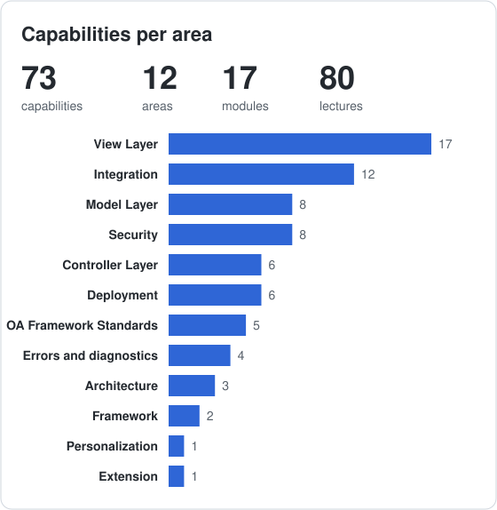
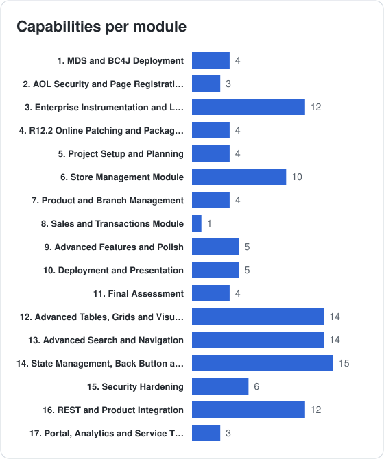

# Oracle OAF Building BootCamp 103

**Code:** `OAF-B-103` &nbsp;·&nbsp; **Level:** Ninja

**Difficulty**

|  |  |  |  |  |
| :-: | :-: | :-: | :-: | :-: |
| **Beginner** | **Elementary** | **Intermediate** | **Advanced** | **Expert** |

## Prerequisites

- Completed Building BootCamp 102
- Able to build an interactive OAF application

## Course Goals

- Design and architect complete enterprise applications
- Build production-ready OAF systems from scratch
- Implement complex business logic and workflows
- Apply advanced design patterns and best practices
- Optimize performance of large-scale applications
- Lead OAF development projects
- Mentor junior developers

<table>
<tr><th align="left">Curriculum</th><th align="left">Capabilities Statistics</th></tr>
<tr><td valign="top">

| Section | Module | Title | Difficulty | Lectures |
| :-: | :-- | :-- | :-- | :-: |
| [1] | B103-001 | [MDS and BC4J Deployment](#1-mds-and-bc4j-deployment) |  | 2 |
| [2] | B103-002 | [AOL Security and Page Registration](#2-aol-security-and-page-registration) |  | 2 |
| [3] | B103-003 | [Enterprise Instrumentation and Log Management](#3-enterprise-instrumentation-and-log-management) |  | 5 |
| [4] | B103-004 | [R12.2 Online Patching and Packaging](#4-r122-online-patching-and-packaging) |  | 3 |
| [5] | B103-005 | [Project Setup and Planning](#5-project-setup-and-planning) |  | 5 |
| [6] | B103-006 | [Store Management Module](#6-store-management-module) |  | 5 |
| [7] | B103-007 | [Product and Branch Management](#7-product-and-branch-management) |  | 4 |
| [8] | B103-008 | [Sales and Transactions Module](#8-sales-and-transactions-module) |  | 3 |
| [9] | B103-009 | [Advanced Features and Polish](#9-advanced-features-and-polish) |  | 3 |
| [10] | B103-010 | [Deployment and Presentation](#10-deployment-and-presentation) |  | 4 |
| [11] | B103-011 | [Final Assessment](#11-final-assessment) |  | 6 |
| [12] | B103-012 | [Advanced Tables, Grids and Visualization](#12-advanced-tables-grids-and-visualization) |  | 8 |
| [13] | B103-013 | [Advanced Search and Navigation](#13-advanced-search-and-navigation) |  | 8 |
| [14] | B103-014 | [State Management, Back Button and Security](#14-state-management-back-button-and-security) |  | 8 |
| [15] | B103-015 | [Security Hardening](#15-security-hardening) |  | 4 |
| [16] | B103-016 | [REST and Product Integration](#16-rest-and-product-integration) |  | 7 |
| [17] | B103-017 | [Portal, Analytics and Service Testing](#17-portal-analytics-and-service-testing) |  | 3 |

</td><td valign="top">

Capabilities taught in this course, from the [capability index](../../CAPABILITIES.md).

</td></tr>
</table>

## [1] MDS and BC4J Deployment

**Module:** B103-001 | **Difficulty:**   

| Code | Lecture | Format | Difficulty | Resource | Notes |
| :-- | :-------- | :-: | :-- | :-- | :---- |
| B103-001.001 | Deploying Pages with XMLImporter | Lab |  | Guide | -rootdir, -username, -password, -dbconnection parameters, $JAVA_TOP layout |
| B103-001.002 | Registering BC4J Configuration with JPXImporter | Lab |  | Guide | .jpx project files, classpath specifications, repository registration |

## [2] AOL Security and Page Registration

**Module:** B103-002 | **Difficulty:**   

| Code | Lecture | Format | Difficulty | Resource | Notes |
| :-- | :-------- | :-: | :-- | :-- | :---- |
| B103-002.001 | Defining Form Functions for OAF Pages | Lab |  | Guide | SSWA jsp function, page path and parameters |
| B103-002.002 | Configuring Menus and Responsibilities | Lab |  | Guide | Attaching functions to menus, assigning responsibilities, testing access |

## [3] Enterprise Instrumentation and Log Management

**Module:** B103-003 | **Difficulty:**   

| Code | Lecture | Format | Difficulty | Resource | Notes |
| :-- | :-------- | :-: | :-- | :-- | :---- |
| B103-003.001 | Configuring the FND_LOG Framework and Profile Options | Lab |  | Guide | FND: Debug Log Enabled, FND: Debug Log Level, FND_LOG_MESSAGES |
| B103-003.002 | Writing Diagnostics from Code | Lab |  | Tutorial | pageContext.writeDiagnostics(), screen logging, performance tracing; SQL trace with event 10046 |
| B103-003.003 | Purging Logs with FNDLGPRG | Lab |  | Guide | Concurrent program schedule, FND_LOG_ADMIN package, table storage and size checks |
| B103-003.004 | Tracing SQL with Event 10046 | Lab |  | Guide | SQL trace with event 10046, reading trace output, finding slow statements |
| B103-003.005 | Tuning View Object Queries: Range Size and Fetch Strategy | Lab |  | Tutorial | Tuning view object queries, range size, fetch mode, bind variables, SQL plans, row-fetch limits |

## [4] R12.2 Online Patching and Packaging

**Module:** B103-004 | **Difficulty:**   

| Code | Lecture | Format | Difficulty | Resource | Notes |
| :-- | :-------- | :-: | :-- | :-- | :---- |
| B103-004.001 | Using Online Patching (adop) Fundamentals | Video |  | Diagram | Run edition versus patch edition, patch phases, classpath configuration |
| B103-004.002 | Compiling and Archiving with adcgnjar | Lab |  | Guide | $AD_TOP/bin/adcgnjar, customall.jar, signed archives under $JAVA_TOP |
| B103-004.003 | Scripting Repeatable Deployments | Lab |  | Project | Environment variables such as $AD_APPS_JDBC_URL in place of hardcoded connection strings, run on R12.2 |

## [5] Project Setup and Planning

**Module:** B103-005 | **Difficulty:**   

| Code | Lecture | Format | Difficulty | Resource | Notes |
| :-- | :-------- | :-: | :-- | :-- | :---- |
| B103-005.001 | Setting-Up Development Environment | Lab |  | Guide | Professional workspace setup, team collaboration tools, code repository structure |
| B103-005.002 | Installing Git (Version Control System) | Lab |  | Tutorial | Git fundamentals, branching strategy, commit conventions, pull requests |
| B103-005.003 | Creating Workspaces and Projects | Lab |  | Template | Project structure, naming conventions, module organization |
| B103-005.004 | Creating and Testing a Database Connection | Lab |  | Guide | Development database, connection pooling, testing connectivity |
| B103-005.005 | Installing the Database Objects | Lab |  | Scripts | Database schema design, tables and relationships, sequences and triggers, sample data |

## [6] Store Management Module

**Module:** B103-006 | **Difficulty:**   

| Code | Lecture | Format | Difficulty | Resource | Notes |
| :-- | :-------- | :-: | :-- | :-- | :---- |
| B103-006.001 | Implementing Store Query Page (SELECT) | Lab |  | Project | Search functionality, multiple criteria, results table, pagination, export to Excel |
| B103-006.002 | Implementing Store Drill-Down Page (SELECT) | Lab |  | Project | Master-detail display, related information, navigation, breadcrumbs |
| B103-006.003 | Implementing Store Create Page (INSERT) | Lab |  | Project | Data entry form, validation, confirmation, success message |
| B103-006.004 | Implementing Store Delete Page (DELETE) | Lab |  | Project | Confirmation dialog, business rule validation, cascade delete handling, audit trail |
| B103-006.005 | Implementing Store Update Page (UPDATE) | Lab |  | Project | Edit form, version control, concurrent update handling, change tracking |

## [7] Product and Branch Management

**Module:** B103-007 | **Difficulty:**   

| Code | Lecture | Format | Difficulty | Resource | Notes |
| :-- | :-------- | :-: | :-- | :-- | :---- |
| B103-007.001 | Explaining the Practice Assignment | Workshop |  | Project | Requirements specification, business rules, acceptance criteria, deliverables |
| B103-007.002 | Implementing Product CRUD Functionality | Lab |  | Project | Query page, create page, update page, delete functionality, drill-down details |
| B103-007.003 | Explaining the Practice Solution | Workshop |  | Rubric | Solution walkthrough, best practices applied, alternative approaches, lessons learned |
| B103-007.004 | Implementing Branch Page (Master-Details) | Lab |  | Project | Master: Branch info, address, contact, hours; Detail 1: Store assignments with shuttle; Detail 2: Employee assignments with advanced table; Detail 3: Inventory summary with PPR |

## [8] Sales and Transactions Module

**Module:** B103-008 | **Difficulty:**   

| Code | Lecture | Format | Difficulty | Resource | Notes |
| :-- | :-------- | :-: | :-- | :-- | :---- |
| B103-008.001 | Processing Sales Transactions | Lab |  | Project | POS interface, product selection, quantity and pricing, discounts, payment, receipts |
| B103-008.002 | Managing Inventory | Lab |  | Project | Stock tracking, reorder alerts, transfer between stores, inventory reports |
| B103-008.003 | Reporting and Analytics | Lab |  | Project | Sales reports, inventory reports, employee performance, charts and graphs, export |

## [9] Advanced Features and Polish

**Module:** B103-009 | **Difficulty:**   

| Code | Lecture | Format | Difficulty | Resource | Notes |
| :-- | :-------- | :-: | :-- | :-- | :---- |
| B103-009.001 | Implementing Advanced Features | Lab |  | Project | Attachments for documents, workflow integration, audit trail, security, multi-language support |
| B103-009.002 | Optimizing Performance | Lab |  | Project | Query optimization, caching strategies, large data set handling, response time improvement |
| B103-009.003 | Handling Errors and Logging | Lab |  | Project | Comprehensive error messages, debug logging, production monitoring, user help system |

## [10] Deployment and Presentation

**Module:** B103-010 | **Difficulty:**   

| Code | Lecture | Format | Difficulty | Resource | Notes |
| :-- | :-------- | :-: | :-- | :-- | :---- |
| B103-010.001 | Deploying to Production | Lab |  | Guide | Deployment package creation, installation instructions, production deployment, post-deployment validation |
| B103-010.002 | Writing Documentation | Workshop |  | Template | Technical documentation, user manual, installation guide, troubleshooting guide |
| B103-010.003 | Presenting the Project | Workshop |  | Guide | Demo preparation, presentation to stakeholders, Q&A handling |
| B103-010.004 | Mentoring and Code Review | Workshop |  | Guide | Reviewing a peer implementation, giving actionable feedback, coaching a junior developer through a defect, review checklist |

## [11] Final Assessment

**Module:** B103-011 | **Difficulty:**   

| Code | Lecture | Format | Difficulty | Resource | Notes |
| :-- | :-------- | :-: | :-- | :-- | :---- |
| B103-011.001 | Applying the Comprehensive Evaluation Criteria | Workshop |  | Rubric | Functional Completeness (30%): All modules working, business rules implemented, no critical bugs |
| B103-011.002 | Assessing Code Quality | Workshop |  | Guide | Code Quality (25%): Standards compliance, maintainability, documentation, test coverage |
| B103-011.003 | Reviewing Architecture and Design | Workshop |  | Patterns | Architecture & Design (20%): MVC implementation, scalability, reusability, performance |
| B103-011.004 | Reviewing Professional Deliverables | Workshop |  | Checklist | Professional Deliverables (15%): Complete documentation, deployment package, user manual, presentation |
| B103-011.005 | Showcasing Innovation and Excellence | Workshop |  | Project | Innovation & Excellence (10%): Creative solutions, additional features, problem-solving, exceeding requirements |
| B103-011.006 | Earning Ninja Level Certification | Workshop |  | Rubric | Success Criteria: Score ≥ 85% on all criteria, production-ready application, professional presentation, complete documentation, demonstrates mastery |

## [12] Advanced Tables, Grids and Visualization

**Module:** B103-012 | **Difficulty:**   

| Code | Lecture | Format | Difficulty | Resource | Notes |
| :-- | :-------- | :-: | :-- | :-- | :---- |
| B103-012.001 | Building Advanced Tables | Lab |  | Guide | Column groups, sortable headers, selection, total rows, detail disclosure, table-in-table |
| B103-012.002 | Migrating from Classic Tables | Video |  | Guide | Comparison with advanced tables, usage limits, migration strategy |
| B103-012.003 | Implementing Rich Table Interactions | Lab |  | Guide | Resize, reorder, freeze, hide/show columns, scrolling; touch-device optimizations |
| B103-012.004 | Exporting Table Data | Lab |  | Guide | enableExcelExport and enablePDFExport properties, Excel and PDF export, transient columns, export limits *(verify)* |
| B103-012.005 | Building HGrid and Tree Regions | Lab |  | Project | OAHGridBean, OATreeBean, focus and hierarchy columns, child row retrieval |
| B103-012.006 | Building Charts, Graphs and Infotiles | Lab |  | Guide | BI beans and JET transition, Gantt, Infotiles *(verify)* |
| B103-012.007 | Building Masonry Layout Dashboards | Lab |  | Guide | Grid-based responsive dashboards, status tiles, KPI cards *(verify)* |
| B103-012.008 | Building Gantt Charts | Lab |  | Guide | Gantt chart region bound to project schedule data |

## [13] Advanced Search and Navigation

**Module:** B103-013 | **Difficulty:**   

| Code | Lecture | Format | Difficulty | Resource | Notes |
| :-- | :-------- | :-: | :-- | :-- | :---- |
| B103-013.001 | Designing the Search Architecture | Lab |  | Guide | Query regions, simple and advanced search, results-based search |
| B103-013.002 | Implementing the List Search Framework | Lab |  | Guide | Filter panels, saved searches, quick and keyword search |
| B103-013.003 | Implementing Infotile-Driven Search | Lab |  | Project | Summary tiles with metric counts that filter a results table |
| B103-013.004 | Implementing Quick Search and Side Navigation Search | Lab |  | Guide | Compact quick search inputs in global headers and side navigation |
| B103-013.005 | Using Navigation Components | Lab |  | Guide | Trains, subtabs, accordions, hide/show, popups, shuttles |
| B103-013.006 | Implementing Declarative Page Flows | Lab |  | Guide | Destination function and workflow page flows, transaction state, save for later |
| B103-013.007 | Building Accordion Navigation | Lab |  | Guide | Accordion regions and hide/show navigation containers |
| B103-013.008 | Building Sub Tabs and Sliding Sub Tab Layouts | Lab |  | Guide | subTabLayout, subTabBar and hideShowSubTabLayout with slide-out content panels |

## [14] State Management, Back Button and Security

**Module:** B103-014 | **Difficulty:**   

| Code | Lecture | Format | Difficulty | Resource | Notes |
| :-- | :-------- | :-: | :-- | :-- | :---- |
| B103-014.001 | Applying Advanced Entity Mechanics | Lab |  | Guide | Polymorphic entities, parent/child posting order, transient attributes |
| B103-014.002 | Building PL/SQL Entity Objects | Lab |  | Guide | Wrapping legacy PL/SQL table APIs, key generation, locking, error mapping |
| B103-014.003 | Managing State Retention and Pooling | Video |  | Guide | Retention levels, passivation, session limits, connection pool monitoring |
| B103-014.004 | Applying Resource Swapping and Memory Caching | Video |  | Guide | AM pooling and resource swapping, JDBC pool tuning, memory caching, resource conservation |
| B103-014.005 | Supporting the Browser Back Button | Lab |  | Guide | Page instance IDs, transaction units, back-button detection |
| B103-014.006 | Securing Pages, Functions and Data | Lab |  | Guide | Function security, data grants, page access tracking |
| B103-014.007 | Hardening Input Against Attacks | Lab |  | Guide | XSS scanning, AntiSamy HTML filtering, virus scanning, frame busting |
| B103-014.008 | Applying Polymorphic Entity Objects | Lab |  | Guide | Polymorphic entity objects with subtype-specific validation |

## [15] Security Hardening

**Module:** B103-015 | **Difficulty:**   

| Code | Lecture | Format | Difficulty | Resource | Notes |
| :-- | :-------- | :-: | :-- | :-- | :---- |
| B103-015.001 | Tracking Page Access | Lab |  | Guide | Page access tracking, reviewing who opened which page |
| B103-015.002 | Scanning Pages for Cross-Site Scripting | Lab |  | Checklist | XSS scanning, AntiSamy HTML filtering and fixing findings |
| B103-015.003 | Applying Frame Busting Protection | Lab |  | Guide | Frame busting against clickjacking and framed pages |
| B103-015.004 | Scanning Uploaded Files for Viruses | Lab |  | Guide | Virus scanning on file upload, rejecting infected files |

## [16] REST and Product Integration

**Module:** B103-016 | **Difficulty:**   

| Code | Lecture | Format | Difficulty | Resource | Notes |
| :-- | :-------- | :-: | :-- | :-- | :---- |
| B103-016.001 | Using the OAF REST Servlet | Lab |  | Guide | Exposing AM methods, service data objects, testing business service objects; BSO API tester |
| B103-016.002 | Using Application Web Services | Video |  | Guide | Business service objects, attachments service, home page service |
| B103-016.003 | Consuming External SOAP and REST Services | Lab |  | Project | Calling external services from application module code, error handling, timeouts |
| B103-016.004 | Integrating Forms and Workflow | Lab |  | Guide | Launching Forms from OAF and back, worklist notifications; JTT application launch and parameter passing *(verify the term and scope)* |
| B103-016.005 | Embedding Portal Content and Analytics | Video |  | Guide | Portlet integration, embedding analytics *(verify)*; OBIEE analytics embedding |
| B103-016.006 | Reviewing and Approving Workflow Notifications from OAF | Lab |  | Guide | Notification pages, approve and reject actions, worklist review |
| B103-016.007 | Embedding Oracle JET Components and Third-Party Web Apps | Lab |  | Tutorial | OARichContainerBean, Oracle JET components, third-party web applications embedded in OAF pages *(verify)* |

## [17] Portal, Analytics and Service Testing

**Module:** B103-017 | **Difficulty:**   

| Code | Lecture | Format | Difficulty | Resource | Notes |
| :-- | :-------- | :-: | :-- | :-- | :---- |
| B103-017.001 | Publishing OAF Regions as Portlets | Lab |  | Guide | Portlet publishing to WebCenter Portal and WSRP portals |
| B103-017.002 | Embedding OBIEE Analytics | Lab |  | Guide | OBIEE analytics embedded in an OAF page *(verify)* |
| B103-017.003 | Testing Services with the BSO API Tester | Lab |  | Guide | BSO tester, testing business service objects and REST calls |
