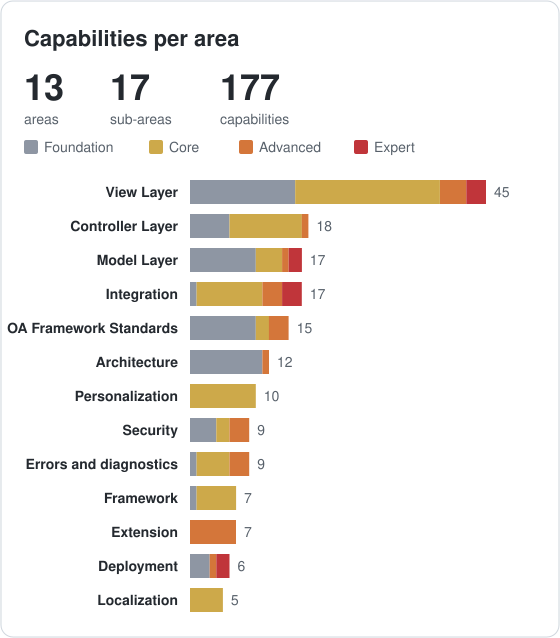
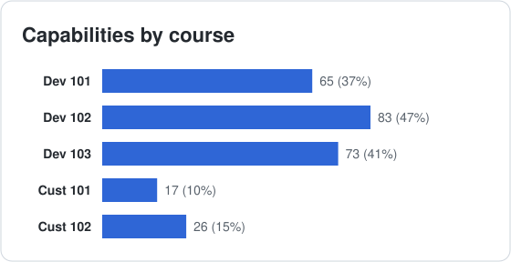

# Oracle OAF BootCamp Capabilities

Every OAF capability covered by the five courses, with its Level, the courses that teach it and up to five lectures (lectures that name the capability come first).

**Courses:** [Dev 101](../courses/building/101/README.md), [Dev 102](../courses/building/102/README.md), [Dev 103](../courses/building/103/README.md), [Cust 101](../courses/customizing/101/README.md), [Cust 102](../courses/customizing/102/README.md).

**Level** shows how advanced a capability is, taken from the lowest course that teaches it.

|  **Foundation** |  **Core** |  **Advanced** |  **Expert** |
| :-: | :-: | :-: | :-: |

**Courses** lists every course that teaches the capability.

<table>
<tr><th align="left">Summary</th><th align="left">Statistics</th></tr>
<tr><td valign="top">

| Area | Capabilities |
| :-- | :-: |
| **[Architecture](#architecture)** | **12** |
| ↳ [Concepts and Layers](#concepts-and-layers) | 6 |
| ↳ [Runtime and Data Foundations](#runtime-and-data-foundations) | 6 |
| **[Model Layer](#model-layer)** | **17** |
| ↳ [Business Components](#business-components) | 10 |
| ↳ [Validation and Server-Side Logic](#validation-and-server-side-logic) | 7 |
| **[View Layer](#view-layer)** | **45** |
| ↳ [Layout Containers](#layout-containers) | 11 |
| ↳ [Navigation and Page Structure](#navigation-and-page-structure) | 10 |
| ↳ [Tables, Search and Visualization](#tables-search-and-visualization) | 10 |
| ↳ [Widgets, Items and Forms](#widgets-items-and-forms) | 14 |
| **[Controller Layer](#controller-layer)** | **18** |
| ↳ [Request Processing](#request-processing) | 7 |
| ↳ [State and Navigation](#state-and-navigation) | 6 |
| ↳ [Dynamic and Programmatic UI](#dynamic-and-programmatic-ui) | 5 |
| [Framework](#framework) | 7 |
| [Localization](#localization) | 5 |
| **[Integration](#integration)** | **17** |
| ↳ [Files and Data Exchange](#files-and-data-exchange) | 6 |
| ↳ [Services and APIs](#services-and-apis) | 4 |
| ↳ [EBS Products and Processes](#ebs-products-and-processes) | 7 |
| [Security](#security) | 9 |
| [Errors and diagnostics](#errors-and-diagnostics) | 9 |
| [Personalization](#personalization) | 10 |
| [Extension](#extension) | 7 |
| [Deployment](#deployment) | 6 |
| **[OA Framework Standards](#oa-framework-standards)** | **15** |
| ↳ [Coding and Naming Standards](#coding-and-naming-standards) | 6 |
| ↳ [Project and Code Management](#project-and-code-management) | 4 |
| ↳ [Quality and Extension Practice](#quality-and-extension-practice) | 5 |
| **Total** | **177** |

</td><td valign="top">

</td></tr>
</table>

## Architecture

### Concepts and Layers

| Capability | Level | Courses | Lectures |
| :-- | :-: | :-- | :-- |
| MVC pattern |  | Dev 101, Dev 103 | B101-002.005, B101-004.001, B101-009.001, B103-011.003 |
| UIX and MDS metadata |  | Dev 101, Dev 102, Cust 101, Cust 102 | B101-002.006, B101-007.001, B102-010.002, C101-001.003, C101-002.003 |
| OAF terminology and page anatomy |  | Dev 101 | B101-002.001, B101-002.007 |
| OAF in context (when to use, EBS integration) |  | Dev 101 | B101-002.003, B101-002.004 |
| Layered application architecture |  | Dev 101 | B101-002.008 |
| Object-oriented reuse |  | Dev 101, Dev 102 | B101-007.004, B102-009.004 |

### Runtime and Data Foundations

| Capability | Level | Courses | Lectures |
| :-- | :-: | :-- | :-- |
| BC4J (business components) |  | Dev 101, Dev 103 | B101-002.006, B101-004.001, B103-001.002 |
| JDeveloper and OA Extension |  | Dev 101 | B101-003.001, B101-003.004, B101-003.010, B101-011.002, B101-013.006 |
| State and connection management (AM pooling, retention, passivation) |  | Dev 101, Dev 103 | B103-014.003, B101-004.005, B101-003.007, B101-004.002, B101-009.006 |
| Enterprise performance (resource swapping and caching) |  | Dev 103 | B103-014.004, B103-009.002 |
| Database layer (_B and _TL tables) |  | Dev 101 | B101-002.009 |
| System catalog views |  | Dev 101 | B101-002.010 |

## Model Layer

### Business Components

| Capability | Level | Courses | Lectures |
| :-- | :-: | :-- | :-- |
| Entity objects |  | Dev 101, Dev 102, Dev 103, Cust 102 | B101-006.001, B101-006.002, B101-006.004, B103-014.002, B103-014.008 |
| View objects, bind variables and criteria |  | Dev 101, Dev 103 | B101-005.004, B103-003.005 |
| Updatable and read-only view objects |  | Dev 101 | B101-005.001, B101-005.002, B101-005.003 |
| View links |  | Dev 101 | B101-005.005, B101-010.001, B101-015.002 |
| Application modules and OADBTransaction |  | Dev 101, Dev 103, Cust 102 | B101-004.004, B101-004.002, B101-004.003, B101-015.002, C102-002.003 |
| Master-detail pages |  | Dev 101, Dev 103 | B101-010.001, B101-010.002, B101-015.004, B103-007.004, B101-005.005 |
| Entity associations |  | Dev 101 | B101-006.004 |
| Polymorphic entity objects |  | Dev 103 | B103-014.008, B103-014.001 |
| Multi-Org (operating unit) context |  | Dev 101, Dev 102 | B102-008.008, B101-012.003 |
| View object query performance |  | Dev 103 | B103-003.005 |

### Validation and Server-Side Logic

| Capability | Level | Courses | Lectures |
| :-- | :-: | :-- | :-- |
| Validation view objects |  | Dev 102 | B102-008.007 |
| Entity expert validation |  | Dev 102 | B102-009.004 |
| Attribute validation and primary keys |  | Dev 101, Dev 102 | B101-006.003, B101-006.005, B102-009.003 |
| Cross-attribute validation |  | Dev 101 | B101-006.005 |
| SQL and PL/SQL calls from OAF |  | Dev 102 | B102-008.004, B102-008.005 |
| PL/SQL entity objects |  | Dev 103 | B103-014.002 |
| Programmatic view objects |  | Dev 102 | B102-008.001, B102-008.002, B102-008.003 |

## View Layer

### Layout Containers

| Capability | Level | Courses | Lectures |
| :-- | :-: | :-- | :-- |
| Pages and regions |  | Dev 101, Cust 102 | B101-007.003, C102-006.001 |
| messageComponentLayout |  | Dev 101 | B101-007.007 |
| Stack, flow, table, row and cell layouts |  | Dev 102 | B102-011.006, B102-011.002 |
| Panel splitter and layered layout |  | Dev 102 | B102-011.005 |
| Layered layout modes (redirect and form submission) |  | Dev 102 | B102-011.007 |
| Auto-repeating layout |  | Dev 102 | B102-012.005 |
| Bulleted list |  | Dev 102 | B102-012.004 |
| Flexible layout and configurable pages |  | Dev 102 | B102-013.005 |
| Masonry layout |  | Dev 103 | B103-012.007 |
| Advanced layout and content container regions |  | Dev 102 | B102-011.003, B102-011.004 |
| Section headers, hide/show regions and footers |  | Dev 101, Dev 102 | B101-007.010, B102-011.001 |

### Navigation and Page Structure

| Capability | Level | Courses | Lectures |
| :-- | :-: | :-- | :-- |
| Sub tabs and navigation components |  | Dev 102, Dev 103 | B103-013.005, B102-011.001, B103-013.008, B103-012.003, B103-013.007 |
| Train and wizards |  | Dev 102, Dev 103 | B102-013.001, B102-013.003, B103-013.005 |
| Shuttle |  | Dev 102, Dev 103 | B102-013.002, B103-007.004, B103-013.005 |
| Accordions |  | Dev 103 | B103-013.007, B103-013.005 |
| Popups |  | Dev 103 | B103-013.005 |
| Breadcrumbs and menus |  | Dev 101, Dev 103 | B101-007.014, B103-006.002 |
| Look-and-feel standards |  | Dev 101 | B101-007.008, B101-008.004 |
| Attribute sets and CSS |  | Dev 101, Cust 102 | B101-007.013, C102-006.001 |
| Shared regions and pages |  | Dev 101 | B101-007.004 |
| Switcher |  | Dev 102 | B102-007.007 |

### Tables, Search and Visualization

| Capability | Level | Courses | Lectures |
| :-- | :-: | :-- | :-- |
| Advanced tables |  | Dev 102, Dev 103 | B102-006.001, B103-012.001, B102-006.002, B103-007.004, B103-012.002 |
| Table columns, totals and row selection |  | Dev 102, Dev 103 | B102-006.001, B102-006.002, B103-012.001 |
| Rich table features (resize, reorder, freeze, detach) |  | Dev 103 | B103-012.003 |
| HGrid and tree |  | Dev 102, Dev 103 | B102-012.002, B103-012.005 |
| Infotiles |  | Dev 103 | B103-012.006, B103-013.003 |
| Charts and graphs |  | Dev 102, Dev 103 | B102-012.003, B103-012.006, B103-012.008, B103-008.003 |
| Gantt charts |  | Dev 103 | B103-012.008, B103-012.006 |
| Query region, list search and saved search |  | Dev 101, Dev 102, Dev 103 | B102-012.001, B103-013.002, B101-007.006, B103-013.001 |
| Quick search |  | Dev 103 | B103-013.004 |
| CRUD pages (query, create, update, delete) |  | Dev 103 | B103-006.001, B103-006.002, B103-006.003, B103-006.004, B103-006.005 |

### Widgets, Items and Forms

| Capability | Level | Courses | Lectures |
| :-- | :-: | :-- | :-- |
| Standard web widgets |  | Dev 101 | B101-007.005 |
| Form inputs and selection controls (radio, checkbox, spin box) |  | Dev 101 | B101-007.009 |
| Text and display items |  | Dev 101, Dev 102 | B101-007.011, B102-014.004 |
| Images, spacers and separators |  | Dev 101 | B101-007.011, B101-008.002 |
| Buttons and button bars |  | Dev 101 | B101-007.010, B101-008.005 |
| Form parameters and includes |  | Dev 101 | B101-007.012, B101-008.003 |
| LOV auto-completion, dependent LOV and look-ahead |  | Dev 102 | B102-003.002, B102-003.003, B102-003.004, B102-003.001 |
| Smart poplists (LOV choice) |  | Dev 101, Dev 102 | B101-008.001, B101-007.009, B102-003.005 |
| Lookup codes and value sets |  | Dev 102 | B102-003.005 |
| Date picker and calendar fields |  | Dev 102 | B102-009.005 |
| Rich text, color picker and rating bar |  | Dev 102 | B102-013.004 |
| Flexfields (DFF and KFF) |  | Dev 102, Cust 101 | B102-014.001, B102-014.002, B102-014.007, C101-003.003 |
| Dynamic item properties (SPEL) |  | Dev 102 | B102-014.003, B102-007.007 |
| Attachment mapping |  | Dev 102 | B102-016.001 |

## Controller Layer

### Request Processing

| Capability | Level | Courses | Lectures |
| :-- | :-: | :-- | :-- |
| processRequest (GET) |  | Dev 101, Cust 102 | B101-009.002, C102-001.001 |
| processFormRequest (POST) |  | Dev 102, Cust 102 | B102-001.001, B102-001.003, B102-002.002, C102-001.001 |
| Partial page rendering (PPR) |  | Dev 102, Dev 103 | B102-002.001, B102-002.002, B102-011.001, B103-007.004 |
| Page context and web bean API |  | Dev 101, Dev 102, Dev 103 | B101-009.003, B102-005.002, B103-003.002 |
| Common controller patterns |  | Dev 102 | B102-001.002 |
| processFormData |  | Dev 102 | B102-001.003 |
| Controller classes (OAControllerImpl) |  | Dev 101 | B101-009.008 |

### State and Navigation

| Capability | Level | Courses | Lectures |
| :-- | :-: | :-- | :-- |
| Parameter passing |  | Dev 101, Dev 102, Dev 103, Cust 101, Cust 102 | B101-007.012, B101-008.003, B101-009.004, B101-009.005, B101-009.006 |
| Session parameters and user state |  | Dev 101 | B101-009.007 |
| Dialog pages |  | Dev 102 | B102-005.001, B102-005.002 |
| Back button |  | Dev 102, Dev 103 | B102-017.001, B103-014.005 |
| Deep links |  | Dev 102 | B102-017.003 |
| Declarative page flows |  | Dev 103 | B103-013.006 |

### Dynamic and Programmatic UI

| Capability | Level | Courses | Lectures |
| :-- | :-: | :-- | :-- |
| Programmatic beans |  | Dev 102 | B102-007.001, B102-007.002, B102-007.003, B102-007.004, B102-007.005 |
| Dynamic focus and bean properties |  | Dev 102, Dev 103 | B102-007.006, B103-012.005 |
| Table row actions |  | Dev 102 | B102-006.002, B102-006.003 |
| JavaScript |  | Dev 101, Dev 102 | B102-015.001, B101-007.010, B102-014.004 |
| Read-only pages and page modes |  | Dev 102 | B102-015.002 |

## Framework

| Capability | Level | Courses | Lectures |
| :-- | :-: | :-- | :-- |
| Accessibility |  | Dev 102, Cust 101 | B102-018.004, C101-003.003 |
| Accelerator (hot) keys |  | Dev 102 | B102-018.002 |
| Screen reader support |  | Dev 102 | B102-018.002 |
| Enhanced save model |  | Dev 102 | B102-018.003 |
| Profile options |  | Dev 102, Dev 103, Cust 101 | B102-010.003, B103-003.001, C101-002.002, C101-005.001 |
| Default values |  | Dev 101, Dev 102, Cust 102 | B102-010.001, B101-007.009, B101-009.002, C102-002.002 |
| Context-sensitive help |  | Dev 102 | B102-018.005 |

## Localization

| Capability | Level | Courses | Lectures |
| :-- | :-: | :-- | :-- |
| Multi-language support |  | Dev 102, Dev 103 | B102-018.001, B103-009.001 |
| Right-to-left layouts |  | Dev 102 | B102-018.001 |
| Timezones |  | Dev 102 | B102-009.001, B102-018.001 |
| Date formats |  | Dev 102 | B102-009.001 |
| Number and currency formats |  | Dev 102 | B102-009.002 |

## Integration

### Files and Data Exchange

| Capability | Level | Courses | Lectures |
| :-- | :-: | :-- | :-- |
| Attachments |  | Dev 102, Dev 103 | B102-016.001, B103-009.001, B103-016.002 |
| File upload and download |  | Dev 102, Dev 103 | B102-016.002, B102-016.006, B102-016.009, B103-015.004, B102-016.005 |
| Import and export data |  | Dev 102 | B102-016.003, B102-016.004 |
| Export to Excel and PDF |  | Dev 102, Dev 103 | B103-011.005, B103-012.004, B102-016.003, B102-016.004, B102-016.008 |
| XML Publisher and BI Publisher output |  | Dev 102 | B102-016.007, B102-012.003 |
| Web ADI integration |  | Dev 102 | B102-016.008, B102-016.009 |

### Services and APIs

| Capability | Level | Courses | Lectures |
| :-- | :-: | :-- | :-- |
| REST and web services |  | Dev 103 | B103-016.001, B103-016.002 |
| BSO tester |  | Dev 103 | B103-017.003, B103-016.001 |
| External SOAP and REST services |  | Dev 103 | B103-016.003 |
| Embedded JET and third-party content |  | Dev 103 | B103-016.007 |

### EBS Products and Processes

| Capability | Level | Courses | Lectures |
| :-- | :-: | :-- | :-- |
| Workflow and notifications |  | Dev 102, Dev 103 | B103-016.006, B102-017.002, B103-016.004, B102-005.002, B102-017.005 |
| Business events |  | Dev 102 | B102-017.005 |
| Oracle Forms interoperability |  | Dev 101, Dev 102 | B101-002.002, B102-014.005, B102-014.006 |
| Portal and portlets |  | Dev 103 | B103-017.001, B103-016.005 |
| Concurrent requests |  | Dev 102, Dev 103 | B102-017.004, B102-017.006, B103-003.003, B103-006.005 |
| Programmatic concurrent request submission |  | Dev 102 | B102-017.006 |
| OBIEE analytics |  | Dev 103 | B103-017.002, B103-016.005 |

## Security

| Capability | Level | Courses | Lectures |
| :-- | :-: | :-- | :-- |
| Function security |  | Dev 101, Dev 103 | B101-012.002, B101-012.001, B103-014.006 |
| Data security |  | Dev 101 | B101-012.003 |
| Authentication and authorization |  | Dev 101 | B101-012.001 |
| XSS scanning |  | Dev 103 | B103-014.007, B103-015.002 |
| AntiSamy filtering |  | Dev 102, Dev 103 | B103-014.007, B103-015.002, B102-016.005 |
| Virus scanning |  | Dev 102, Dev 103 | B103-015.004, B102-016.005, B103-014.007 |
| Frame busting |  | Dev 103 | B103-015.003, B103-014.007 |
| Built-in protection against HTML tampering |  | Dev 101 | B101-012.004, B101-012.005 |
| Page access tracking |  | Dev 103 | B103-014.006, B103-015.001 |

## Errors and diagnostics

| Capability | Level | Courses | Lectures |
| :-- | :-: | :-- | :-- |
| OAException and severities |  | Dev 102 | B102-004.002, B102-004.001 |
| Bundled exceptions |  | Dev 102 | B102-004.003, B102-004.002 |
| Debugger and logging |  | Dev 101, Dev 103 | B101-011.001, B101-011.002, B103-009.003, B103-003.002 |
| About This Page |  | Dev 102, Cust 101 | B102-019.003, C101-005.001 |
| OAInfo.jsp |  | Dev 102 | B102-019.003 |
| FND_LOG and writeDiagnostics |  | Dev 103 | B103-003.001, B103-003.002, B103-003.003 |
| SQL trace (event 10046) |  | Dev 103 | B103-003.004, B103-003.002 |
| Log purge (FNDLGPRG) |  | Dev 103 | B103-003.003 |
| Advanced debugging techniques |  | Dev 102 | B102-019.001, B102-019.002 |

## Personalization

| Capability | Level | Courses | Lectures |
| :-- | :-: | :-- | :-- |
| Customization concepts |  | Cust 101 | C101-001.001 |
| Personalization levels |  | Cust 101 | C101-002.001 |
| Personalization precedence (user level highest) |  | Cust 101 | C101-002.004 |
| Durable personalizations |  | Cust 101 | C101-001.002 |
| Region injection |  | Cust 101 | C101-003.004 |
| LOV personalization |  | Cust 101 | C101-003.005 |
| XMLExporter and XMLImporter |  | Dev 103, Cust 101, Cust 102 | B103-001.001, C101-004.001, C101-004.002, C101-005.002, C101-005.003 |
| Translated personalizations |  | Cust 101 | C101-005.002 |
| End-user and declarative page personalization |  | Cust 101 | C101-001.004, C101-003.001, C101-003.002 |
| MDS content inspection |  | Cust 101 | C101-004.003 |

## Extension

| Capability | Level | Courses | Lectures |
| :-- | :-: | :-- | :-- |
| Controller extension |  | Cust 102 | C102-001.001 |
| View object extension |  | Cust 102 | C102-002.001 |
| Entity object extension |  | Cust 102 | C102-002.002 |
| Application module extension |  | Cust 102 | C102-002.003 |
| Substitution and JPX |  | Dev 103, Cust 102 | B103-001.002, C102-003.001, C102-003.002, C102-001.002, C102-003.003 |
| LOV extension |  | Cust 102 | C102-001.002 |
| Extension touchpoints and Oracle page extensions |  | Cust 102 | C102-005.002, C102-005.004 |

## Deployment

| Capability | Level | Courses | Lectures |
| :-- | :-: | :-- | :-- |
| Deployment to EBS |  | Dev 101, Dev 103, Cust 102 | B101-014.001, B101-014.004, B103-004.003, C102-004.002, B101-014.002 |
| adop and R12.2 patching |  | Dev 101, Dev 103, Cust 102 | B103-004.001, B101-014.003, C102-004.003, C102-006.004 |
| adcgnjar and customall.jar |  | Dev 103, Cust 102 | B103-004.002, C102-004.001 |
| AOL functions, menus and responsibilities |  | Dev 101, Dev 102, Dev 103, Cust 101, Cust 102 | B101-003.008, B103-002.001, B103-002.002, B101-012.002, B101-014.004 |
| Scripted deployment |  | Dev 103 | B103-004.003 |
| Environment promotion |  | Cust 102 | C102-006.003 |

## OA Framework Standards

### Coding and Naming Standards

| Capability | Level | Courses | Lectures |
| :-- | :-: | :-- | :-- |
| Why development standards matter |  | Dev 101 | B101-013.001 |
| Coding standards and naming conventions |  | Dev 101 | B101-013.002 |
| Oracle, project and industry standards |  | Dev 101 | B101-013.003 |
| File types and package naming |  | Dev 101 | B101-013.004 |
| Directory structure ($JAVA_TOP) |  | Dev 101 | B101-013.005 |
| Common page patterns |  | Dev 101 | B101-013.007 |

### Project and Code Management

| Capability | Level | Courses | Lectures |
| :-- | :-: | :-- | :-- |
| Workspace and project organization |  | Dev 101, Dev 103 | B101-003.010, B101-007.002, B103-005.003, B101-003.001, B101-013.005 |
| Code management and version control |  | Dev 101, Dev 102, Dev 103, Cust 102 | B101-003.010, B101-013.006, B103-005.002, B102-020.001, B103-006.005 |
| Project documentation and delivery |  | Dev 103 | B103-010.001, B103-010.002, B103-010.003 |
| Mentoring and code review |  | Dev 101, Dev 103 | B103-010.004, B101-001.003 |

### Quality and Extension Practice

| Capability | Level | Courses | Lectures |
| :-- | :-: | :-- | :-- |
| Extension standards |  | Cust 102 | C102-005.001 |
| Custom code placement |  | Cust 102 | C102-005.003 |
| Server-side best practices |  | Dev 102 | B102-008.006 |
| Unit and automated testing |  | Dev 102 | B102-019.004 |
| Code quality and standards compliance |  | Dev 101, Dev 102, Dev 103 | B103-011.002, B101-015.006, B102-020.006 |

## UI Component Layout Index

Bean-level OAF component names for each capability that has them, grouped by OAF component category. Look up the lectures in the capability's row.

| # | Group | Capability | # | Component |
| :-- | :-- | :-- | :-- | :-- |
| C01 | Layout containers | Pages and regions | C01.001 C01.002 C01.003 C01.004 | page pageLayout attributeSet package |
| C02 |  | messageComponentLayout | C02.001 C02.002 C02.003 C02.004 C02.005 | messageComponentLayout messageLayout labeledFieldLayout defaultSingleColumn defaultDoubleColumn |
| C03 |  | Stack, flow, table, row and cell layouts | C03.001 C03.002 C03.003 C03.004 C03.005 | stackLayout flowLayout rowLayout tableLayout cellFormat |
| C04 |  | Panel splitter and layered layout | C04.001 C04.002 | panelSplitter layeredLayout |
| C05 |  | Flexible layout and configurable pages | C05.001 C05.002 C05.003 | flexibleLayout flexibleContent flexibleContentList |
| C06 |  | Advanced layout and content container regions | C06.001 C06.002 | contentContainer richContainer |
| C07 |  | Section headers, hide/show regions and footers | C07.001 C07.002 C07.003 C07.004 | header hideShowHeader footer contentFooter |
| C08 | Data presentation | Bulleted list | C08.001 | bulletedList |
| C09 |  | Advanced tables | C09.001 C09.002 | table advancedTable |
| C10 |  | Table columns, totals and row selection | C10.001 C10.002 C10.003 C10.004 C10.005 C10.006 | columnGroup sortableHeader totalRow addTableRow singleSelection multipleSelection |
| C11 |  | HGrid and tree | C11.001 C11.002 C11.003 C11.004 | HGrid tree nodeDef childNode |
| C12 |  | Infotiles | C12.001 | infotile |
| C13 | Navigation and page flow | Sub tabs and navigation components | C13.001 C13.002 C13.003 | subTabLayout subTabBar hideShowSubTabLayout |
| C14 |  | Train and wizards | C14.001 | train |
| C15 |  | Breadcrumbs and menus | C15.001 C15.002 C15.003 C15.004 C15.005 | menu menuItem breadcrumbs locator navigationBar |
| C16 | Input and item controls | Shuttle | C16.001 | shuttle |
| C17 |  | Popups | C17.001 | popUp |
| C18 |  | Form inputs and selection controls (radio, checkbox, spin box) | C18.001 C18.002 C18.003 C18.004 C18.005 C18.006 C18.007 | messageTextInput messageChoice messageLovChoice messageRadioButton messageRadioGroup messageCheckBox messageSpinBox |
| C19 |  | Text and display items | C19.001 C19.002 C19.003 C19.004 C19.005 C19.006 | styledText formattedText instructionText messageStyledText staticStyledText rawText |
| C20 |  | Images, spacers and separators | C20.001 C20.002 C20.003 C20.004 | image spacer separator tip |
| C21 |  | Buttons and button bars | C21.001 C21.002 C21.003 C21.004 C21.005 C21.006 C21.007 | button submitButton resetButton selectionButton exportButton link pageButtonBar |
| C22 |  | Form parameters and includes | C22.001 C22.002 C22.003 C22.004 | formParameter formValue servletInclude urlInclude |
| C23 |  | LOV auto-completion, dependent LOV and look-ahead | C23.001 C23.002 C23.003 C23.004 C23.005 | listOfValues messageLovInput lovMap lovActionButton lovActionMap |
| C24 |  | Rich text, color picker and rating bar | C24.001 C24.002 C24.003 | richTextEditor colorPicker messageRatingBar |
| C25 |  | Flexfields (DFF and KFF) | C25.001 C25.002 | flex flexMap |
| C26 |  | Dialog pages | C26.001 | dialogPage |
| C27 | Attachment and file controls | Attachment mapping | C27.001 C27.002 C27.003 C27.004 C27.005 C27.006 C27.007 | attachmentTable attachmentLink attachmentImage messageInlineAttachment entityMap categoryMap primaryKey |
| C28 |  | File upload and download | C28.001 C28.002 | messageFileUpload messageDownload |
| C29 | Analytics and charts | Charts and graphs | C29.001 C29.002 C29.003 | graphTable graph graphData |
| C30 |  | Gantt charts | C30.001 | Gantt |

## Notes

- A capability counts as covered when a lecture name or note names it. This shows where a topic is taught, not how deeply.
- The list is built from the capability catalogs supplied for this course, not from an official Oracle list.
- Levels are derived from where lectures name each capability (a few basics are set by hand), so they are not an official Oracle grading.
- The content has not been reviewed by an instructor.
