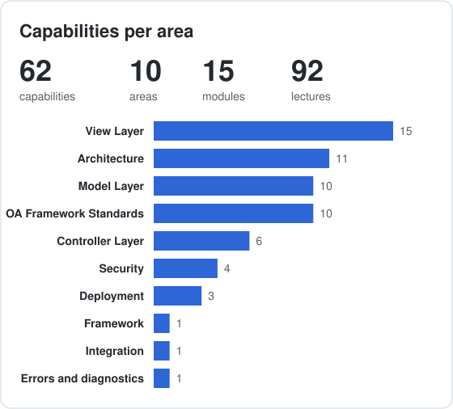
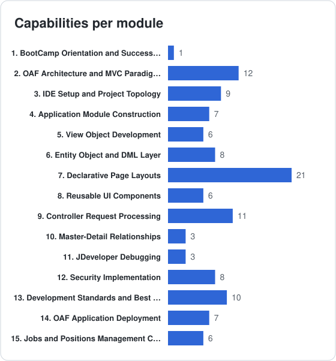

# Oracle OAF Building BootCamp 101

**Code:** `OAF-B-101` &nbsp;·&nbsp; **Level:** Beginner

**Curriculum specification only.** Lecture formats and resources describe planned teaching approaches. See the [curriculum conventions](../../../CURRICULUM.md) for scope, difficulty, workload and release applicability.

## Purpose and Audience

Build the conceptual and practical foundations for a secure, transactional OAF CRUD application and a training-environment deployment.

**Audience:** Developers and technical consultants with Java and SQL foundations who are new to OAF.

## Prerequisites

- Basic Java classes, inheritance and exceptions
- SQL joins, DML, keys and constraints; ability to read PL/SQL
- Basic HTML and familiarity with EBS responsibilities

**Readiness check:** Explain a Java subclass, a SQL join and rollback; identify an EBS responsibility. OAF experience is not required.

## Course Goals

- Explain MVC, BC4J, entity validation and transaction ownership for a CRUD request.
- Specify the matching OA Extension environment, DBC connection requirements and project/package conventions.
- Design EO-backed and read-only VOs, associations, view links and a root AM for master-detail data.
- Select page components and trace initialization, Save, Cancel, Delete, validation and user messages.
- Explain a debugging approach, function/data authorization checks and an R12.2 training deployment sequence.
- Defend a bounded Jobs and Positions design against CRUD, consistency, usability and deployment criteria.

## Outcomes and Coverage

Required outcomes define the exit competencies. Elective outcomes extend them and carry no compulsory assessment marks.

| Outcome | Path | Modules | Observable capability |
| :-- | :-- | :-- | :-- |
| B101-LO01 | Required | [B101-002](#2-oaf-architecture-and-mvc-paradigms-required), [B101-004](#4-application-module-construction-required), [B101-006](#6-entity-object-and-dml-layer-required), [B101-005](#5-view-object-development-required) | Explain MVC, BC4J, entity validation and transaction ownership for a CRUD request. |
| B101-LO02 | Required | [B101-003](#3-ide-setup-and-project-topology-required), [B101-013](#13-development-standards-and-best-practices-required) | Specify the matching OA Extension environment, DBC connection requirements and project/package conventions. |
| B101-LO03 | Required | [B101-006](#6-entity-object-and-dml-layer-required), [B101-005](#5-view-object-development-required), [B101-004](#4-application-module-construction-required), [B101-010](#10-master-detail-relationships-required) | Design EO-backed and read-only VOs, associations, view links and a root AM for master-detail data. |
| B101-LO04 | Required | [B101-007](#7-declarative-page-layouts-required), [B101-009](#9-controller-request-processing-required) | Select page components and trace initialization, Save, Cancel, Delete, validation and user messages. |
| B101-LO05 | Required | [B101-011](#11-jdeveloper-debugging-required), [B101-012](#12-security-implementation-required), [B101-014](#14-oaf-application-deployment-required) | Explain a debugging approach, function/data authorization checks and an R12.2 training deployment sequence. |
| B101-LO06 | Required | [B101-015](#15-jobs-and-positions-management-capstone-required) | Defend a bounded Jobs and Positions design against CRUD, consistency, usability and deployment criteria. |
| B101-LOE1 | Elective | [B101-008](#8-reusable-ui-components-elective) | Evaluate shared-region, smart-poplist and button-bar reuse beyond the required page design. |

## Learning Path and Workload

Follow the table from top to bottom and skip electives unless their outcomes are needed. Module and lecture IDs are stable references, so their numeric order can differ from the teaching order. The module prerequisites below explain the dependencies.

| Path | Instruction h | Independent study h | Assessment preparation h | Total h |
| :-- | --: | --: | --: | --: |
| Required | 32.5 | 25 | 20 | 77.5 |
| Elective additions | 2 | 1.5 | 0 | 3.5 |

At **10 hours a week**, the required path is approximately **7.8 weeks**. These are editorial estimates pending pilot data; instruction, study and assessment time are additive and counted once. Alternative project options share the same assessment allowance. Elective extensions inside required modules are excluded from required assessment and from scheduled hours; their additional time is set when selected. Fully elective module hours are shown separately. Conditional product-specific topics are unscheduled until scoped.

**Difficulty:** ★ Beginner · ★★ Elementary · ★★★ Intermediate · ★★★★ Advanced · ★★★★★ Expert. Ratings describe prerequisite depth and reasoning complexity, independently of Video/Lab/Workshop format. Module difficulty represents its central task; individual lectures can differ.

## Curriculum

| Teaching step | Module | Title | Path | Difficulty | Lectures | Instruction h | Study h | Assessment h |
| --: | :-- | :-- | :-- | :-- | --: | --: | --: | --: |
| 1 | B101-001 | [BootCamp Orientation and Success Path](#1-bootcamp-orientation-and-success-path-required) | Required |  | 4 | 1 | 1 | 0 |
| 2 | B101-002 | [OAF Architecture and MVC Paradigms](#2-oaf-architecture-and-mvc-paradigms-required) | Required |  | 10 | 3 | 2.5 | 0 |
| 3 | B101-003 | [IDE Setup and Project Topology](#3-ide-setup-and-project-topology-required) | Required |  | 10 | 3 | 2.5 | 0 |
| 4 | B101-004 | [Application Module Construction](#4-application-module-construction-required) | Required |  | 5 | 2 | 1.5 | 0 |
| 5 | B101-006 | [Entity Object and DML Layer](#6-entity-object-and-dml-layer-required) | Required |  | 5 | 2.5 | 2 | 0 |
| 6 | B101-005 | [View Object Development](#5-view-object-development-required) | Required |  | 5 | 3 | 2.5 | 0 |
| 7 | B101-007 | [Declarative Page Layouts](#7-declarative-page-layouts-required) | Required |  | 14 | 4 | 3 | 0 |
| 8 | B101-009 | [Controller Request Processing](#9-controller-request-processing-required) | Required |  | 11 | 4 | 3 | 0 |
| 9 | B101-010 | [Master-Detail Relationships](#10-master-detail-relationships-required) | Required |  | 2 | 1.5 | 1.5 | 0 |
| 10 | B101-011 | [JDeveloper Debugging](#11-jdeveloper-debugging-required) | Required |  | 2 | 1 | 1 | 0 |
| 11 | B101-012 | [Security Implementation](#12-security-implementation-required) | Required |  | 5 | 2 | 1.5 | 0 |
| 12 | B101-013 | [Development Standards and Best Practices](#13-development-standards-and-best-practices-required) | Required |  | 7 | 1.5 | 1.5 | 0 |
| 13 | B101-014 | [OAF Application Deployment](#14-oaf-application-deployment-required) | Required |  | 4 | 2 | 1.5 | 0 |
| 14 | B101-015 | [Jobs and Positions Management Capstone](#15-jobs-and-positions-management-capstone-required) | Required |  | 6 | 2 | 0 | 20 |
| 15 | B101-008 | [Reusable UI Components](#8-reusable-ui-components-elective) | Elective |  | 5 | 2 | 1.5 | 0 |

## Coverage Statistics

The [capability index](../../../capabilities/CAPABILITIES.md) locates planned topics, including electives. Counts do not measure competency or implementation availability.

## [1] BootCamp Orientation and Success Path (Required)

**Module:** B101-001 | **Difficulty:**  | **Path:** Required

**Prerequisites:** Course entry criteria.

**Module outcome:** Describe the course boundaries, required path and completion criteria.

| Code | Lecture | Format | Difficulty | Planned resource | Curriculum scope |
| :-- | :-- | :-: | :-- | :-- | :-- |
| B101-001.001 | Introducing the OAF BootCamp | Video |  | Guide | Transformation roadmap, success stories, instructor intro |
| B101-001.002 | Understanding the BootCamp Structure and Learning Model | Video |  | Guide | Three-level progression, scaffolding approach, assessment |
| B101-001.003 | Joining the Learning Community | Video |  | Guide | Study groups, code review, forums, peer learning |
| B101-001.004 | Setting Goals and Success Strategies | Workshop |  | Template | SMART goals, time management, growth mindset |

## [2] OAF Architecture and MVC Paradigms (Required)

**Module:** B101-002 | **Difficulty:**  | **Path:** Required

**Prerequisites:** [B101-001](#1-bootcamp-orientation-and-success-path-required).

**Module outcome:** Map a user request to OAF, MVC, BC4J, metadata and database responsibilities.

| Code | Lecture | Format | Difficulty | Planned resource | Curriculum scope |
| :-- | :-- | :-: | :-- | :-- | :-- |
| B101-002.001 | Learning OAF Terminology | Video |  | Reference | Vocabulary, naming conventions, EBS context |
| B101-002.002 | Tracing the Evolution from Oracle Forms to OAF | Video |  | Diagram | Technology shift, migration strategies, use cases |
| B101-002.003 | Choosing When and Why to Use OAF | Video |  | Diagram | Advantages, limitations, business case |
| B101-002.004 | Integrating OAF with E-Business Suite | Video |  | Guide | Evolution, Oracle's direction, EBS integration |
| B101-002.005 | Separating Model, View and Controller in OAF | Video |  | Diagram | Model-View-Controller, separation of concerns |
| B101-002.006 | Understanding BC4J and UIX Architecture | Video |  | Guide | BC4J, UIX, lifecycle, metadata repository |
| B101-002.007 | Examining OAF Page Anatomy | Video |  | Reference | AM, VO, EO, Pages, Regions, Controllers |
| B101-002.008 | Understanding the Layered Application Architecture | Video |  | Diagram | Layered application architecture: database, entity object, view object and AM, shared region and page layers |
| B101-002.009 | Mapping the Database Layer to Base and TL Tables | Video |  | Reference | Database layer: _B and _TL tables, sequences, packages and WHO columns |
| B101-002.010 | Querying System Catalog Views for OAF Metadata | Video |  | Reference | System catalog views for finding the tables, columns and dependencies behind a page |

## [3] IDE Setup and Project Topology (Required)

**Module:** B101-003 | **Difficulty:**  | **Path:** Required

**Prerequisites:** [B101-002](#2-oaf-architecture-and-mvc-paradigms-required).

**Module outcome:** Identify a matching development environment and explain connectivity and Hello World checkpoints.

| Code | Lecture | Format | Difficulty | Planned resource | Curriculum scope |
| :-- | :-- | :-: | :-- | :-- | :-- |
| B101-003.001 | Navigating the JDeveloper IDE | Video |  | Reference | IDE layout, panels, workspace organization |
| B101-003.002 | Downloading OA Extension from Oracle Support | Video |  | Guide | MOS portal, version matrix, download process |
| B101-003.003 | Configuring the Development Environment | Video |  | Checklist | Installation, OA Extension, configuration, DBC; directories (jdevbin, jdevhome, jdevdoc), JDEV_USER_HOME and JDEV_JAVA_HOME |
| B101-003.004 | Using JDeveloper Tools and Shortcuts | Video |  | Reference | Interface customization, shortcuts, templates |
| B101-003.005 | Using the Structure Pane, Inspector and UML Modeler | Lab |  | Guide | Hierarchy navigation, property sheets, UML modeling of business components, local debugging tools |
| B101-003.006 | Configuring DBC Files and Database Connections | Video |  | Guide | DBC setup, connection parameters, validation |
| B101-003.007 | Establishing Database Connectivity | Video |  | Guide | Connection setup, pooling, multi-environment; setup verification with test_fwktutorial.jsp |
| B101-003.008 | Registering Short Names and Responsibility Keys | Lab |  | Guide | Application short name, responsibility key, FWK_TBX_TUTORIAL setup for local testing |
| B101-003.009 | Building the First Hello World OAF Page | Lab |  | Tutorial | First page, AM, layout, components, run |
| B101-003.010 | Organizing Workspaces and Version Control in JDeveloper | Video |  | Template | Workspace organization, naming, version control |

## [4] Application Module Construction (Required)

**Module:** B101-004 | **Difficulty:**  | **Path:** Required

**Prerequisites:** [B101-003](#3-ide-setup-and-project-topology-required).

**Module outcome:** Explain AM composition and model-side transaction ownership.

| Code | Lecture | Format | Difficulty | Planned resource | Curriculum scope |
| :-- | :-- | :-: | :-- | :-- | :-- |
| B101-004.001 | Managing Business Data with BC4J | Video |  | Guide | Understanding BC4J, MVC role, component ecosystem |
| B101-004.002 | Designing Application Modules | Video |  | Guide | AM structure, transactions, pooling, patterns |
| B101-004.003 | Building and Testing an Application Module | Lab |  | Guide | Step-by-step creation, testing, debugging |
| B101-004.004 | Accessing OADBTransaction from the Application Module | Lab |  | Guide | OADBTransaction responsibilities and model-side access; introduce commit/rollback concepts, then apply them in B101-009 |
| B101-004.005 | Managing Transactions and Connection Pooling | Video |  | Patterns | Connection pooling, commits, locking, tuning |

## [6] Entity Object and DML Layer (Required)

**Module:** B101-006 | **Difficulty:**  | **Path:** Required

**Prerequisites:** [B101-004](#4-application-module-construction-required).

**Module outcome:** Define entity keys, associations and validation before introducing updatable VOs.

| Code | Lecture | Format | Difficulty | Planned resource | Curriculum scope |
| :-- | :-- | :-: | :-- | :-- | :-- |
| B101-006.001 | Understanding Entity Object Fundamentals | Video |  | Reference | Table mapping, validation, DML, associations |
| B101-006.002 | Creating Entity Objects from Tables | Lab |  | Tutorial | Wizard creation, attributes, validation rules |
| B101-006.003 | Defining Primary Keys and Attribute Validation | Lab |  | Tutorial | Primary key identification, attribute-level validation routines, entity-level validation |
| B101-006.004 | Defining Entity Associations Between Entity Objects | Lab |  | Tutorial | Composite and non-composite entity associations, foreign key mapping and association accessors |
| B101-006.005 | Writing Entity-Level and Cross-Attribute Validation | Lab |  | Tutorial | Validation across attributes in an entity object, validation order and error messages |

## [5] View Object Development (Required)

**Module:** B101-005 | **Difficulty:**  | **Path:** Required

**Prerequisites:** [B101-006](#6-entity-object-and-dml-layer-required).

**Module outcome:** Select read-only or EO-backed VOs, bind criteria and view links.

| Code | Lecture | Format | Difficulty | Planned resource | Curriculum scope |
| :-- | :-- | :-: | :-- | :-- | :-- |
| B101-005.001 | Choosing Between Read-Only and Updatable View Objects | Video |  | Guide | Read-only query VOs versus EO-backed updatable VOs; entity construction is taught first in B101-006 |
| B101-005.003 | Building Read-Only View Objects with SQL | Lab |  | Tutorial | SQL-based VOs, expert mode, joins, optimization |
| B101-005.002 | Building Updatable View Objects for CRUD | Lab |  | Tutorial | VO-EO linking, attribute mapping, CRUD testing |
| B101-005.004 | Configuring Bind Variables and View Criteria | Lab |  | Tutorial | Named bind variables, view criteria, dynamic WHERE clauses, search pages, preventing SQL injection |
| B101-005.005 | Linking View Objects with View Links and Associations | Video |  | Reference | Master-detail, FK relationships, domains |

## [7] Declarative Page Layouts (Required)

**Module:** B101-007 | **Difficulty:**  | **Path:** Required

**Prerequisites:** [B101-005](#5-view-object-development-required).

**Module outcome:** Compose a basic accessible page and select appropriate declarative widgets.

| Code | Lecture | Format | Difficulty | Planned resource | Curriculum scope |
| :-- | :-- | :-: | :-- | :-- | :-- |
| B101-007.001 | Composing Pages from UIX Components | Video |  | Guide | Framework basics, component hierarchy, metadata |
| B101-007.002 | Structuring UI Components in the Workspace | Video |  | Guide | Workspace organization, naming, packages, reusable |
| B101-007.003 | Building Pages and Regions | Video |  | Guide | Page structure, region types, hierarchy, containers |
| B101-007.004 | Creating and Reusing Shared Regions, Pages and Items | Lab |  | Tutorial | Shared regions, shared pages, shared items, reuse across page contexts, sharing logistics |
| B101-007.005 | Configuring Standard Web Widgets and Their Properties | Lab |  | Reference | All standard UI widgets and their properties |
| B101-007.006 | Designing Page Layouts and Advanced Regions | Lab |  | Patterns | Layouts, headers, buttons, query regions |
| B101-007.007 | Building Forms with messageComponentLayout | Lab |  | Reference | messageComponentLayout columns and rows, stack layouts; default* form layouts are deprecated in 12.2; messageLayout for non-message beans, labeledFieldLayout |
| B101-007.008 | Applying Look-and-Feel Standards | Video |  | Guide | Oracle look-and-feel standards and BLAF; Redwood theme is documented for OAF 12.2.13/12.2.14, with accessibility caveats; see release scope in CURRICULUM.md |
| B101-007.009 | Using Poplists, Radio Groups, Checkboxes and Spin Boxes | Lab |  | Reference | messageChoice, messageLovChoice, messageRadioGroup, messageCheckBox, messageSpinBox, default values; messageRadioButton |
| B101-007.010 | Using Buttons, Page Button Bars and Content Footers | Lab |  | Reference | button, submitButton, resetButton, selectionButton, exportButton, link and pageButtonBar; distinguish legacy contentFooter from supported page footer patterns |
| B101-007.011 | Adding Images, Spacers, Separators and Static Text | Lab |  | Reference | image, spacer, separator, tip, instructionText, styledText, formattedText; messageStyledText, staticStyledText, rawText, dynamic images from BLOB columns |
| B101-007.012 | Passing Form Parameters and Form Values | Lab |  | Guide | formParameter, formValue, servletInclude and urlInclude concepts; lifecycle and scope are applied in B101-009 |
| B101-007.013 | Applying CSS Styling and Reusable Attribute Sets | Video |  | Guide | CSS styling, attribute sets, theming |
| B101-007.014 | Implementing Navigation with Breadcrumbs and Menus | Video |  | Guide | Breadcrumb configuration, menu integration; locator element |

## [9] Controller Request Processing (Required)

**Module:** B101-009 | **Difficulty:**  | **Path:** Required

**Prerequisites:** [B101-007](#7-declarative-page-layouts-required).

**Module outcome:** Trace GET/POST lifecycle behavior, invoke model operations and explain save/cancel/error paths.

| Code | Lecture | Format | Difficulty | Planned resource | Curriculum scope |
| :-- | :-- | :-: | :-- | :-- | :-- |
| B101-009.001 | Understanding Controller Architecture and User Actions | Video |  | Guide | MVC responsibilities, controller lifecycle, keeping business rules and database operations in the model |
| B101-009.002 | Handling GET Requests and Page Initialization | Video |  | Patterns | processRequest(), initialization, default values |
| B101-009.003 | Using the Controller API for pageContext and WebBeans | Video |  | Reference | pageContext, attributes, WebBeans, transactions |
| B101-009.008 | Creating Controller Classes with OAControllerImpl | Lab |  | Tutorial | OAControllerImpl subclass, region attachment, processRequest and processFormRequest entry points; precedes event handling below |
| B101-009.009 | Handling Basic Form Submissions with processFormRequest | Lab |  | Tutorial | POST lifecycle, identifying Save, Cancel and Delete actions; calling AM methods for commit/rollback; basic navigation |
| B101-009.010 | Providing Validation Messages with OAException | Video |  | Reference | ERROR and CONFIRMATION, message dictionary and tokens, preserving user input; successful operations and error handling use separate control paths |
| B101-009.011 | Applying Safe CRUD and Transaction Boundaries | Workshop |  | Patterns | Model-side validation, one logical transaction, Cancel rollback, delete confirmation and concurrent-update feedback; advanced dialogs follow in B102-005 |
| B101-009.004 | Comparing Parameter Passing Strategies | Video |  | Diagram | Request, Transaction, Session scopes comparison |
| B101-009.005 | Using Request Parameters for Single-Page Scope | Lab |  | Tutorial | Token-based, navigation, lifecycle, examples |
| B101-009.006 | Managing Transaction Parameters Across Pages | Lab |  | Tutorial | Multi-page flow, retention, cleanup |
| B101-009.007 | Storing User State in Session Parameters | Lab |  | Tutorial | Session scope, persistence, memory, best practices |

## [10] Master-Detail Relationships (Required)

**Module:** B101-010 | **Difficulty:**  | **Path:** Required

**Prerequisites:** [B101-009](#9-controller-request-processing-required).

**Module outcome:** Explain synchronization between a master row and detail rows.

| Code | Lecture | Format | Difficulty | Planned resource | Curriculum scope |
| :-- | :-- | :-: | :-- | :-- | :-- |
| B101-010.001 | Understanding Master-Detail with View Links | Video |  | Guide | Parent-child relationships, View Links, use cases |
| B101-010.002 | Implementing Master-Detail User Interfaces | Lab |  | Tutorial | Region configuration, synchronization, cascading |

## [11] JDeveloper Debugging (Required)

**Module:** B101-011 | **Difficulty:**  | **Path:** Required

**Prerequisites:** [B101-009](#9-controller-request-processing-required).

**Module outcome:** Choose breakpoints and diagnostic evidence for a basic fault.

| Code | Lecture | Format | Difficulty | Planned resource | Curriculum scope |
| :-- | :-- | :-: | :-- | :-- | :-- |
| B101-011.001 | Using Console and Logging Debugging Tools | Video |  | Guide | Console output, log files, diagnostic logging |
| B101-011.002 | Debugging with the JDeveloper Debugger | Lab |  | Tutorial | Breakpoints, step-through, variables, remote |

## [12] Security Implementation (Required)

**Module:** B101-012 | **Difficulty:**  | **Path:** Required

**Prerequisites:** [B101-009](#9-controller-request-processing-required).

**Module outcome:** Distinguish authentication, function access, row-level authorization and tampering protection.

| Code | Lecture | Format | Difficulty | Planned resource | Curriculum scope |
| :-- | :-- | :-: | :-- | :-- | :-- |
| B101-012.001 | Distinguishing Authentication from Authorization in OAF | Video |  | Guide | Authentication, authorization, function security, EBS login flow and session timeouts |
| B101-012.002 | Implementing Function Security for Page Access | Lab |  | Tutorial | Function registration, menu setup, responsibilities |
| B101-012.003 | Applying Data Security for Row-Level Protection | Video |  | Patterns | Multi-Org, row-level security, VPD, filtering, data security grants on a search page |
| B101-012.004 | Understanding Built-In HTML Tampering Protection | Video |  | Guide | Automatic guards against HTML tampering and common hacking vectors, what the framework protects by default |
| B101-012.005 | Testing Protection Against HTML Tampering | Lab |  | Checklist | Tampering attempts on hidden fields and URLs, verifying HTML tampering protection |

## [13] Development Standards and Best Practices (Required)

**Module:** B101-013 | **Difficulty:**  | **Path:** Required

**Prerequisites:** [B101-003](#3-ide-setup-and-project-topology-required).

**Module outcome:** Apply naming, package, metadata and page-pattern conventions.

| Code | Lecture | Format | Difficulty | Planned resource | Curriculum scope |
| :-- | :-- | :-: | :-- | :-- | :-- |
| B101-013.001 | Understanding Why Development Standards Matter | Video |  | Guide | Maintainability, team collaboration, Oracle support, upgrades |
| B101-013.002 | Following OAF Coding Standards and Terminology | Video |  | Guide | Naming conventions, package structure, comments, organization |
| B101-013.003 | Comparing Oracle, Project and Industry Standards | Video |  | Diagram | Oracle standards, project-specific, industry best practices |
| B101-013.004 | Organizing Files and Packages in OAF Projects | Video |  | Reference | File types (.xml, .java, .class), package naming, MDS structure |
| B101-013.005 | Understanding the OAF Directory Structure | Video |  | Diagram | $JAVA_TOP structure, workspace organization, resource files |
| B101-013.006 | Using Import and Export Utilities for Code Management | Lab |  | Tutorial | Code extraction from database, importing to JDeveloper, version control; JDeveloper-level only, command-line importers are covered in Dev 103 |
| B101-013.007 | Designing Common Page Patterns and Use Cases | Video |  | Patterns | Search pages, Create/Update pages, Detail/drill-down, List pages |

## [14] OAF Application Deployment (Required)

**Module:** B101-014 | **Difficulty:**  | **Path:** Required

**Prerequisites:** [B101-012](#12-security-implementation-required), [B101-013](#13-development-standards-and-best-practices-required).

**Module outcome:** Explain the R12.2 training deployment and post-deployment access checks.

| Code | Lecture | Format | Difficulty | Planned resource | Curriculum scope |
| :-- | :-- | :-: | :-- | :-- | :-- |
| B101-014.001 | Planning OAF Deployment from Build to Validation | Video |  | Checklist | Compilation, packaging, MDS import, function registration and post-deployment checks; service restart decisions follow the target release documentation |
| B101-014.002 | Comparing R12.1 and R12.2 Deployment Boundaries | Video |  | Tutorial | Historical comparison only: file locations, classpath and packaging differences; assessed deployment planning targets R12.2 |
| B101-014.003 | Planning OAF Deployment on R12.2 | Lab |  | Tutorial | Training-environment deployment sequence, packaging and file-system awareness; production adop lifecycle and synchronization are taught in B103-004 |
| B101-014.004 | Completing Post-Deployment Configuration | Lab |  | Guide | Function registration, menu setup, responsibility assignment, testing |

## [15] Jobs and Positions Management Capstone (Required)

**Module:** B101-015 | **Difficulty:**  | **Path:** Required

**Prerequisites:** [B101-010](#10-master-detail-relationships-required), [B101-011](#11-jdeveloper-debugging-required), [B101-014](#14-oaf-application-deployment-required).

**Module outcome:** Review the Jobs and Positions scenario against all required exit competencies.

| Code | Lecture | Format | Difficulty | Planned resource | Curriculum scope |
| :-- | :-- | :-: | :-- | :-- | :-- |
| B101-015.001 | Creating Database Objects and Entities | Lab |  | Scripts | Tables, sequences, entity objects, WHO columns |
| B101-015.002 | Building View Objects and the Application Module | Lab |  | Project | Job and position VOs, view link, root AM |
| B101-015.003 | Building Job Search and Job Details Pages | Lab |  | Project | Search page, create/update page, controllers |
| B101-015.004 | Implementing Position Maintenance (Master-Detail) | Lab |  | Project | Detail table, add/delete rows, validation |
| B101-015.005 | Testing the Application and Deploying It to EBS | Lab |  | Checklist | Test plan, deployment to EBS, reflection |
| B101-015.006 | Assessing the Capstone Against the 100-Point Rubric | Workshop |  | Rubric | Curriculum assessment review: functional behavior 35, model and validation 20, controller and transactions 15, security and deployment 15, explanation and usability 15; see Assessment Design |

## [8] Reusable UI Components (Elective)

**Module:** B101-008 | **Difficulty:**  | **Path:** Elective

**Prerequisites:** [B101-007](#7-declarative-page-layouts-required), [B101-009](#9-controller-request-processing-required).

**Module outcome:** Evaluate reuse of UI composition, parameters and common button behavior.

| Code | Lecture | Format | Difficulty | Planned resource | Curriculum scope |
| :-- | :-- | :-: | :-- | :-- | :-- |
| B101-008.001 | Building Smart Poplists with LOV Choice Lists | Lab |  | Tutorial | Elective: basic messageLovChoice and smart poplist configuration; searchable LOV construction and dependent mappings are deferred to B102-003 |
| B101-008.002 | Reviewing Reusable UI Composition Decisions | Workshop |  | Tutorial | Compare spacer, separator and image choices for reusable regions; evaluate consistency and accessibility rather than repeat widget introduction |
| B101-008.003 | Designing Parameter Contracts for Shared Regions | Lab |  | Tutorial | formParameter and formValue contracts across reusable regions; dependencies and retention trade-offs beyond basic passing in B101-009 |
| B101-008.004 | Reviewing Look-and-Feel Consistency Across Pages | Workshop |  | Guide | Review shared styles and attribute sets across several pages; compare maintainability and accessible presentation |
| B101-008.005 | Designing Reusable Page Button Bars | Lab |  | Tutorial | pageButtonBar conventions across forms, shared Save/Apply/Cancel behavior; applies B101-009 lifecycle knowledge |

## Assessment Design

**Scenario:** Jobs and Positions Management. Jobs and positions only: search, create/update/delete, a master-detail relationship, date/head-count rules, WHO columns, Save/Cancel behavior and access controls. Excludes seeded HR product replacement, PPR and workflow.

This specifies assessment coverage and evidence for future delivery. It does not supply assignments, lab instructions, solution code or a production deployment. Evidence may combine a design explanation, lifecycle trace, scenario analysis and, when a delivered course requires it, an implementation demonstration.

| Criterion | Weight | Outcomes | Expected evidence |
| :-- | --: | :-- | :-- |
| Functional behavior | 35% | B101-LO01, B101-LO03, B101-LO04, B101-LO06 | CRUD and master-detail behavior, valid/invalid inputs and expected results. |
| Model and validation | 20% | B101-LO01, B101-LO03 | Keys, associations, bind parameters, WHO columns and server-side business rules. |
| Controller and transactions | 15% | B101-LO04 | GET/POST trace, Save, Cancel, Delete, confirmation and concurrent-update behavior. |
| Security and deployment | 15% | B101-LO02, B101-LO05 | Denied access and tampered-input cases; environment assumptions and deployment checks. |
| Explanation and usability | 15% | B101-LO02, B101-LO05, B101-LO06 | Naming and package rationale, diagnostic approach, clear labels and design defense. |

**Completion threshold:** at least **70/100 overall**, at least **70% within each criterion**, and every critical criterion below satisfied. Optional features cannot replace required evidence.

**Critical criteria:** An unauthorized operation is denied; invalid data cannot be committed; Cancel has an explicit rollback outcome.

**Scoring anchors:** 0% = absent or incorrect; 50% = partly correct with substantial gaps; 70% = meets the stated requirement with minor gaps; 85% = correct, justified and supported by failure-case reasoning; 100% = complete and precise with convincing trade-off analysis. A failed critical criterion requires revision and reassessment of the affected evidence.

## Exit Competencies and Next Step

Completion means the learner can demonstrate every **Required** outcome above within the stated scenario and assessment threshold. Course titles and completion milestones are provider-defined; they do not confer Oracle certification or establish production competence without supervised delivery experience.

**Next:** Building 102 for interactive applications, or Customizing 101 for declarative personalization.

[BootCamp overview](../../../../README.md) · [Curriculum conventions and references](../../../CURRICULUM.md) · [Roadmap](../../../../roadmap/README.md)
