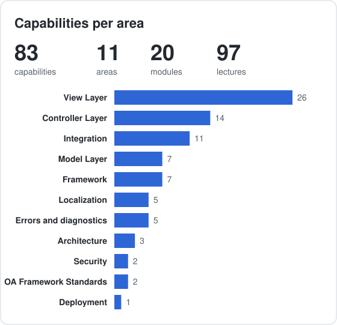
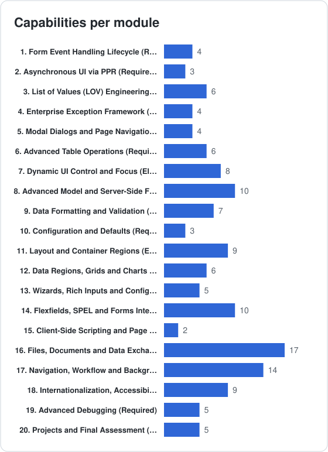

# Oracle OAF Building BootCamp 102

**Code:** `OAF-B-102` &nbsp;·&nbsp; **Level:** Advanced

**Curriculum specification only.** Lecture formats and resources describe planned teaching approaches. See the [curriculum conventions](../../../CURRICULUM.md) for scope, difficulty, workload and release applicability.

## Purpose and Audience

Design interactive, recoverable and accessible applications using PPR, LOVs, advanced tables and stronger model validation.

**Audience:** OAF developers who can already explain and implement basic CRUD behavior and deployment.

## Prerequisites

- Building 101 exit competencies or equivalent evidence
- Explain MVC separation, basic POST handling, OAException, validation and commit/rollback
- Basic approval-state and background-processing concepts; the course introduces their EBS integration boundaries

**Readiness check:** Trace Save and Cancel through controller and AM responsibilities; explain a master-detail relationship and access-denial behavior.

## Course Goals

- Analyze POST/validation ordering and choose exception, dialog and multi-page recovery behavior.
- Design PPR, dependent LOV and advanced-table interactions with correct event and row handling.
- Choose model-side validation, bind parameters, PL/SQL/JDBC boundaries, Multi-Org context, defaults and formatting.
- Design approval-state, Back Button, deep-link and background-request behavior; explain optional Workflow and Business Event integration.
- Specify localization and accessibility behavior and select native diagnostics and regression evidence.
- Defend an interactive request application against the required outcomes without relying on optional integrations.

## Outcomes and Coverage

Required outcomes define the exit competencies. Elective outcomes extend them and carry no compulsory assessment marks.

| Outcome | Path | Modules | Observable capability |
| :-- | :-- | :-- | :-- |
| B102-LO01 | Required | [B102-001](#1-form-event-handling-lifecycle-required), [B102-004](#4-enterprise-exception-framework-required), [B102-005](#5-modal-dialogs-and-page-navigation-required) | Analyze POST/validation ordering and choose exception, dialog and multi-page recovery behavior. |
| B102-LO02 | Required | [B102-002](#2-asynchronous-ui-via-ppr-required), [B102-003](#3-list-of-values-lov-engineering-required), [B102-006](#6-advanced-table-operations-required) | Design PPR, dependent LOV and advanced-table interactions with correct event and row handling. |
| B102-LO03 | Required | [B102-008](#8-advanced-model-and-server-side-features-required), [B102-009](#9-data-formatting-and-validation-required), [B102-010](#10-configuration-and-defaults-required) | Choose model-side validation, bind parameters, PL/SQL/JDBC boundaries, Multi-Org context, defaults and formatting. |
| B102-LO04 | Required | [B102-017](#17-navigation-workflow-and-background-processing-required) | Design approval-state, Back Button, deep-link and background-request behavior; explain optional Workflow and Business Event integration. |
| B102-LO05 | Required | [B102-018](#18-internationalization-accessibility-and-usability-required), [B102-019](#19-advanced-debugging-required) | Specify localization and accessibility behavior and select native diagnostics and regression evidence. |
| B102-LO06 | Required | [B102-020](#20-projects-and-final-assessment-required) | Defend an interactive request application against the required outcomes without relying on optional integrations. |
| B102-LOE1 | Elective | [B102-007](#7-dynamic-ui-control-and-focus-elective), [B102-011](#11-layout-and-container-regions-elective), [B102-012](#12-data-regions-grids-and-charts-elective), [B102-013](#13-wizards-rich-inputs-and-configurable-pages-elective) | Choose programmatic UI, specialist layouts, charts, grids, shuttles and multi-step components for a justified use case. |
| B102-LOE2 | Elective | [B102-014](#14-flexfields-spel-and-forms-integration-elective), [B102-015](#15-client-side-scripting-and-page-modes-elective), [B102-016](#16-files-documents-and-data-exchange-elective) | Evaluate flexfields, Forms, JavaScript, attachments, data exchange and reporting with their additional prerequisites. |

## Learning Path and Workload

Follow the table from top to bottom and skip electives unless their outcomes are needed. Module and lecture IDs are stable references, so their numeric order can differ from the teaching order. The module prerequisites below explain the dependencies.

| Path | Instruction h | Independent study h | Assessment preparation h | Total h |
| :-- | --: | --: | --: | --: |
| Required | 28.5 | 22 | 24 | 74.5 |
| Elective additions | 20 | 16.5 | 0 | 36.5 |

At **10 hours a week**, the required path is approximately **7.5 weeks**. These are editorial estimates pending pilot data; instruction, study and assessment time are additive and counted once. Alternative project options share the same assessment allowance. Elective extensions inside required modules are excluded from required assessment and from scheduled hours; their additional time is set when selected. Fully elective module hours are shown separately. Conditional product-specific topics are unscheduled until scoped.

**Difficulty:** ★ Beginner · ★★ Elementary · ★★★ Intermediate · ★★★★ Advanced · ★★★★★ Expert. Ratings describe prerequisite depth and reasoning complexity, independently of Video/Lab/Workshop format. Module difficulty represents its central task; individual lectures can differ.

## Curriculum

| Teaching step | Module | Title | Path | Difficulty | Lectures | Instruction h | Study h | Assessment h |
| --: | :-- | :-- | :-- | :-- | --: | --: | --: | --: |
| 1 | B102-001 | [Form Event Handling Lifecycle](#1-form-event-handling-lifecycle-required) | Required |  | 3 | 1.5 | 1.5 | 0 |
| 2 | B102-004 | [Enterprise Exception Framework](#4-enterprise-exception-framework-required) | Required |  | 3 | 1.5 | 1.5 | 0 |
| 3 | B102-005 | [Modal Dialogs and Page Navigation](#5-modal-dialogs-and-page-navigation-required) | Required |  | 2 | 1.5 | 1.5 | 0 |
| 4 | B102-010 | [Configuration and Defaults](#10-configuration-and-defaults-required) | Required |  | 3 | 1 | 1 | 0 |
| 5 | B102-008 | [Advanced Model and Server-Side Features](#8-advanced-model-and-server-side-features-required) | Required |  | 8 | 4 | 3 | 0 |
| 6 | B102-009 | [Data Formatting and Validation](#9-data-formatting-and-validation-required) | Required |  | 5 | 2.5 | 2 | 0 |
| 7 | B102-002 | [Asynchronous UI via PPR](#2-asynchronous-ui-via-ppr-required) | Required |  | 2 | 2 | 1.5 | 0 |
| 8 | B102-003 | [List of Values (LOV) Engineering](#3-list-of-values-lov-engineering-required) | Required |  | 5 | 3 | 2.5 | 0 |
| 9 | B102-006 | [Advanced Table Operations](#6-advanced-table-operations-required) | Required |  | 3 | 2 | 1.5 | 0 |
| 10 | B102-018 | [Internationalization, Accessibility and Usability](#18-internationalization-accessibility-and-usability-required) | Required |  | 5 | 2.5 | 2 | 0 |
| 11 | B102-019 | [Advanced Debugging](#19-advanced-debugging-required) | Required |  | 4 | 2 | 1.5 | 0 |
| 12 | B102-017 | [Navigation, Workflow and Background Processing](#17-navigation-workflow-and-background-processing-required) | Required |  | 6 | 3 | 2.5 | 0 |
| 13 | B102-020 | [Projects and Final Assessment](#20-projects-and-final-assessment-required) | Required |  | 6 | 2 | 0 | 24 |
| 14 | B102-007 | [Dynamic UI Control and Focus](#7-dynamic-ui-control-and-focus-elective) | Elective |  | 7 | 3 | 2.5 | 0 |
| 15 | B102-011 | [Layout and Container Regions](#11-layout-and-container-regions-elective) | Elective |  | 7 | 3 | 2.5 | 0 |
| 16 | B102-012 | [Data Regions, Grids and Charts](#12-data-regions-grids-and-charts-elective) | Elective |  | 5 | 3 | 2.5 | 0 |
| 17 | B102-013 | [Wizards, Rich Inputs and Configurable Pages](#13-wizards-rich-inputs-and-configurable-pages-elective) | Elective |  | 5 | 3 | 2.5 | 0 |
| 18 | B102-014 | [Flexfields, SPEL and Forms Integration](#14-flexfields-spel-and-forms-integration-elective) | Elective |  | 7 | 3 | 2.5 | 0 |
| 19 | B102-015 | [Client-Side Scripting and Page Modes](#15-client-side-scripting-and-page-modes-elective) | Elective |  | 2 | 1 | 1 | 0 |
| 20 | B102-016 | [Files, Documents and Data Exchange](#16-files-documents-and-data-exchange-elective) | Elective |  | 9 | 4 | 3 | 0 |

## Coverage Statistics

The [capability index](../../../capabilities/CAPABILITIES.md) locates planned topics, including electives. Counts do not measure competency or implementation availability.

## [1] Form Event Handling Lifecycle (Required)

**Module:** B102-001 | **Difficulty:**  | **Path:** Required

**Prerequisites:** Course entry criteria.

**Module outcome:** Analyze postback ordering, validation failures and multi-page controller decisions.

| Code | Lecture | Format | Difficulty | Planned resource | Curriculum scope |
| :-- | :-- | :-: | :-- | :-- | :-- |
| B102-001.001 | Analyzing Form Submission and Validation Order | Video |  | Examples | Builds on B101-009: processFormRequest, validation failures, re-entry and duplicate submission; compare lifecycle decisions rather than repeat basic button handling |
| B102-001.002 | Applying Common Controller Patterns Across Multi-Page Flows | Video |  | Patterns | Common controller patterns for branching navigation, state cleanup and recovery; basic Save/Cancel/Delete belongs to B101-009 |
| B102-001.003 | Reading Request Data with processFormData | Lab |  | Tutorial | processFormData() compared with processFormRequest(), reading submitted values, lifecycle order |

## [4] Enterprise Exception Framework (Required)

**Module:** B102-004 | **Difficulty:**  | **Path:** Required

**Prerequisites:** [B102-001](#1-form-event-handling-lifecycle-required).

**Module outcome:** Choose severity, attribute/row and bundled exceptions for recovery.

| Code | Lecture | Format | Difficulty | Planned resource | Curriculum scope |
| :-- | :-- | :-: | :-- | :-- | :-- |
| B102-004.001 | Handling Exceptions with the OAF Exception Hierarchy | Video |  | Guide | OAException, checked/unchecked, propagation |
| B102-004.002 | Applying Exception Severity Levels and Inline Messages | Lab |  | Guide | OAException severities (ERROR, WARNING, INFORMATION, CONFIRMATION), inline message rendering; OAAttrValException, OARowValException and bundled exceptions |
| B102-004.003 | Raising Bundle/Multiple Error Messages | Lab |  | Examples | Message bundles, multiple validation errors, user-friendly messages, i18n |

## [5] Modal Dialogs and Page Navigation (Required)

**Module:** B102-005 | **Difficulty:**  | **Path:** Required

**Prerequisites:** [B102-004](#4-enterprise-exception-framework-required).

**Module outcome:** Specify confirmation, cancellation and forward navigation without losing transaction state.

| Code | Lecture | Format | Difficulty | Planned resource | Curriculum scope |
| :-- | :-- | :-: | :-- | :-- | :-- |
| B102-005.001 | Providing User Feedback with Messages and Dialog Pages | Video |  | Reference | Error messages, dialogs, tokens, i18n |
| B102-005.002 | Controlling Page Flow with Dialog Pages | Lab |  | Tutorial | OADialogPage, putDialogMessage(), pageContext.forwardImmediately(), confirmation workflows |

## [10] Configuration and Defaults (Required)

**Module:** B102-010 | **Difficulty:**  | **Path:** Required

**Prerequisites:** [B102-001](#1-form-event-handling-lifecycle-required).

**Module outcome:** Explain profile-driven defaults and metadata decisions.

| Code | Lecture | Format | Difficulty | Planned resource | Curriculum scope |
| :-- | :-- | :-: | :-- | :-- | :-- |
| B102-010.001 | Setting Default Values | Lab |  | Tutorial | Text fields, number fields, date fields, techniques and best practices |
| B102-010.002 | Querying Page Metadata in the MDS Repository | Video |  | Guide | How page metadata is stored and queried, from a developer view; MDS architecture and administration are covered in Cust 101 |
| B102-010.003 | Configuring Important Profile Options | Video |  | Reference | Key profile options, impact on behavior, setting programmatically |

## [8] Advanced Model and Server-Side Features (Required)

**Module:** B102-008 | **Difficulty:**  | **Path:** Required

**Prerequisites:** [B102-001](#1-form-event-handling-lifecycle-required).

**Module outcome:** Choose declarative/programmatic VOs, validation queries, PL/SQL and Multi-Org boundaries.

| Code | Lecture | Format | Difficulty | Planned resource | Curriculum scope |
| :-- | :-- | :-: | :-- | :-- | :-- |
| B102-008.001 | Selecting Declarative or Programmatic View Objects | Video |  | Examples | Compare programmatic view objects with declarative VOs; selection criteria, maintainability and runtime metadata limits |
| B102-008.002 | Creating Dynamic View Objects Programmatically | Lab |  | Tutorial | ViewObjectImpl methods, dynamic queries, adding to AM, use cases |
| B102-008.003 | Adding Attributes to View Objects Programmatically | Lab |  | Examples | AttributeDef creation, data types, calculated & transient attributes |
| B102-008.004 | Executing SQL Statements | Lab |  | Tutorial | Using JDBC in OAF, PreparedStatement, handling result sets, connections |
| B102-008.005 | Calling PL/SQL Functions and Procedures | Lab |  | Examples | CallableStatement usage, IN/OUT parameters, function returns, error handling |
| B102-008.006 | Applying Server-Side Best Practices | Video |  | Patterns | PL/SQL vs Java, performance considerations, transaction management |
| B102-008.007 | Developing Validation View Objects | Lab |  | Tutorial | Validation view objects, validation queries, uniqueness and existence checks from entity objects |
| B102-008.008 | Applying Multi-Org Context to View Objects and Pages | Lab |  | Examples | Multi-Org, operating unit context, MO_GLOBAL, MOAC, org-striped view objects |

## [9] Data Formatting and Validation (Required)

**Module:** B102-009 | **Difficulty:**  | **Path:** Required

**Prerequisites:** [B102-008](#8-advanced-model-and-server-side-features-required).

**Module outcome:** Specify date, number and cross-field validation behavior consistently.

| Code | Lecture | Format | Difficulty | Planned resource | Curriculum scope |
| :-- | :-- | :-: | :-- | :-- | :-- |
| B102-009.001 | Manipulating and Formatting Dates | Lab |  | Tutorial | Date comparisons, Oracle date formats, timezone handling, calculations |
| B102-009.002 | Formatting Numbers | Lab |  | Examples | Number formats, currency display, locale considerations, decimal precision |
| B102-009.003 | Implementing Data Validations | Lab |  | Guide | Field-level validation, cross-field validation, business rule validation |
| B102-009.004 | Implementing Validation Using Entity Expert | Lab |  | Tutorial | Entity Expert pattern, shared validation rules across pages, complex business rules, messages |
| B102-009.005 | Building Date Pickers and Calendar Fields | Lab |  | Examples | messageTextInput date type, date picker, calendar input, date range validation |

## [2] Asynchronous UI via PPR (Required)

**Module:** B102-002 | **Difficulty:**  | **Path:** Required

**Prerequisites:** [B102-001](#1-form-event-handling-lifecycle-required).

**Module outcome:** Specify PPR events, target updates and server processing.

| Code | Lecture | Format | Difficulty | Planned resource | Curriculum scope |
| :-- | :-- | :-: | :-- | :-- | :-- |
| B102-002.001 | Enabling Partial Page Rendering (PPR) for Dynamic UI | Lab |  | Tutorial | AJAX in OAF, PPR events, dynamic updates |
| B102-002.002 | Handling PPR Events on the Server | Lab |  | Tutorial | PPR event triggers, dynamic target regions, processFormRequest handling of PPR events |

## [3] List of Values (LOV) Engineering (Required)

**Module:** B102-003 | **Difficulty:**  | **Path:** Required

**Prerequisites:** [B102-002](#2-asynchronous-ui-via-ppr-required), [B102-009](#9-data-formatting-and-validation-required).

**Module outcome:** Design criteria/result mapping for dependent LOVs and value sources.

| Code | Lecture | Format | Difficulty | Planned resource | Curriculum scope |
| :-- | :-- | :-: | :-- | :-- | :-- |
| B102-003.001 | Configuring List of Values (LOV) for Data Selection | Lab |  | Tutorial | Standard, dependent, and external LOVs; listOfValues region, lovMap criteria and result mapping, messageLovInput |
| B102-003.002 | Building Dependent (Cascading) LOVs | Lab |  | Tutorial | Parent-child LOVs, criteria items, dynamic result mapping, clearing dependent fields |
| B102-003.003 | Enabling LOV Auto-Completion and Look-Ahead | Lab |  | Tutorial | Foreign key validation, look-ahead dropdowns, auto-completion, popup LOV fallback |
| B102-003.004 | Wiring LOV Action Buttons and Mappings | Lab |  | Tutorial | lovActionButton, lovActionMap, lovMap return values, actions inside the LOV window |
| B102-003.005 | Using Lookup Codes and Value Sets as LOV and Poplist Sources | Lab |  | Tutorial | FND lookup types and codes, value sets, lookup-backed poplists and LOVs |

## [6] Advanced Table Operations (Required)

**Module:** B102-006 | **Difficulty:**  | **Path:** Required

**Prerequisites:** [B102-003](#3-list-of-values-lov-engineering-required), [B102-005](#5-modal-dialogs-and-page-navigation-required).

**Module outcome:** Design selection, row creation/deletion and atomic multi-row updates.

| Code | Lecture | Format | Difficulty | Planned resource | Curriculum scope |
| :-- | :-- | :-: | :-- | :-- | :-- |
| B102-006.001 | Implementing Advanced Table Region | Lab |  | Tutorial | Selection, sorting, filtering, row actions, footer calculations, performance; tableFooter; singleSelection and multipleSelection row selection items |
| B102-006.002 | Creating and Deleting Table Rows Programmatically | Lab |  | Project | Advanced table row creation, dynamic row deletion, single and multiple row selection, table events |
| B102-006.003 | Building Updateable Summary Pages with Batch Actions | Lab |  | Project | Multi-row table updates, row duplication, batch delete, partial commit handling |

## [18] Internationalization, Accessibility and Usability (Required)

**Module:** B102-018 | **Difficulty:**  | **Path:** Required

**Prerequisites:** [B102-009](#9-data-formatting-and-validation-required).

**Module outcome:** Specify multilingual, right-to-left, timezone, keyboard, screen-reader and unsaved-change behavior.

| Code | Lecture | Format | Difficulty | Planned resource | Curriculum scope |
| :-- | :-- | :-: | :-- | :-- | :-- |
| B102-018.001 | Supporting Multiple Languages and Internationalization | Lab |  | Guide | MLS and _TL tables, timezone conversion, client character encoding, right-to-left alignment |
| B102-018.002 | Enabling Screen Reader Mode, Row Headers and Hot Keys | Lab |  | Checklist | Screen reader optimized mode, rowheadercol and accelerator hot keys; identify correct configuration before the audit in B102-018.004 |
| B102-018.003 | Warning on Unsaved Changes with the Enhanced Save Model | Lab |  | Tutorial | Detecting uncommitted changes, warning before navigating away, save and discard flows |
| B102-018.004 | Auditing Accessibility Compliance of a Page | Lab |  | Checklist | Audit a page design against labels, row headers, keyboard access, contrast and right-to-left behavior; distinguish an audit from configuring individual controls |
| B102-018.005 | Adding Context-Sensitive and Page Help | Video |  | Patterns | Page help, context-sensitive help, help text, help links and user-defined help |

## [19] Advanced Debugging (Required)

**Module:** B102-019 | **Difficulty:**  | **Path:** Required

**Prerequisites:** [B102-004](#4-enterprise-exception-framework-required).

**Module outcome:** Choose native diagnostics and regression evidence without requiring an unpublished library.

| Code | Lecture | Format | Difficulty | Planned resource | Curriculum scope |
| :-- | :-- | :-: | :-- | :-- | :-- |
| B102-019.001 | Evaluating Debugging Utilities and Dependencies | Workshop |  | Tutorial | Compare native diagnostics with optional demasy-oaf libraries; evaluate dependency availability, support and portability; no proprietary library is required |
| B102-019.002 | Applying Advanced Debugging Techniques | Lab |  | Guide | Remote debugging, production debugging, log analysis, performance profiling |
| B102-019.003 | Using the About This Page and OAInfo.jsp Diagnostics | Lab |  | Guide | Page inspector, OAInfo.jsp, technology stack and profile option inspection, regionMap.xml |
| B102-019.004 | Unit Testing and Automating OAF Components | Video |  | Patterns | Unit testing business components, test harness pages, regression and test automation |

## [17] Navigation, Workflow and Background Processing (Required)

**Module:** B102-017 | **Difficulty:**  | **Path:** Required

**Prerequisites:** [B102-005](#5-modal-dialogs-and-page-navigation-required), [B102-006](#6-advanced-table-operations-required).

**Module outcome:** Specify recovery, approval states and background processing; distinguish optional product integrations.

| Code | Lecture | Format | Difficulty | Planned resource | Curriculum scope |
| :-- | :-- | :-: | :-- | :-- | :-- |
| B102-017.001 | Applying Back Button Recovery to Multi-Page Flows | Lab |  | Guide | Basic page revisit and transaction-integrity scenarios; production state-retention failure analysis follows in B103-014 |
| B102-017.002 | Building Workflow-Enabled OAF Applications (Elective) | Lab |  | Tutorial | Launching workflow, passing parameters, monitoring, embedding OAF in notification Elective integration: Oracle Workflow automation; requires Workflow concepts and a configured product environment. Application-level approval states remain required. |
| B102-017.003 | Implementing Deep Links and Bookmarkable URLs | Lab |  | Guide | RF.jsp, OA.jsp and OAD.jsp URLs, passing parameters, security of direct page access |
| B102-017.004 | Designing Concurrent Request Submission and Monitoring | Video |  | Tutorial | Declarative request submission, monitoring requests and parameter contracts; compare with ConcurrentRequest API implementation choices in the later lecture |
| B102-017.005 | Raising and Subscribing to Business Events (Elective) | Lab |  | Examples | Business Event System, raising events from OAF, subscriptions, workflow integration Elective integration: Business Event System; requires event/subscription concepts and a configured Workflow environment. |
| B102-017.006 | Submitting Concurrent Requests Programmatically | Lab |  | Examples | ConcurrentRequest API, FND_REQUESTS page flow, request parameters, tracking request status |

## [20] Projects and Final Assessment (Required)

**Module:** B102-020 | **Difficulty:**  | **Path:** Required

**Prerequisites:** [B102-006](#6-advanced-table-operations-required), [B102-017](#17-navigation-workflow-and-background-processing-required), [B102-018](#18-internationalization-accessibility-and-usability-required), [B102-019](#19-advanced-debugging-required).

**Module outcome:** Review one bounded request application against required outcomes and the published rubric.

| Code | Lecture | Format | Difficulty | Planned resource | Curriculum scope |
| :-- | :-- | :-: | :-- | :-- | :-- |
| B102-020.001 | Planning the Interactive Application Assessment | Workshop |  | Guide | Select one bounded HR request or procurement request scenario; identify required UI behavior, data rules and evidence; no separate POS kickoff or second compulsory project |
| B102-020.002 | Designing an Items Approval Scenario | Workshop |  | Project | Alternative formative case study: item creation, submit/approve/reject states and approval history; email delivery and Oracle Workflow automation are optional extensions |
| B102-020.003 | Defining the Final Assessment Scope | Workshop |  | Guide | Choose Option A or B; shared requirements: search, PPR, dependent LOV, multi-row changes, messages, recoverable navigation, accessibility and authorization rationale |
| B102-020.004 | Specifying an HR Request Application (Option A) | Workshop |  | Project | Bounded employee request and manager decision flow with history; exclude a complete HRIS, payroll and external product integration |
| B102-020.005 | Specifying a Procurement Request Application (Option B) | Workshop |  | Project | Bounded requisition and approval-state flow with budget rules; exclude purchase-order creation in seeded products and external integration |
| B102-020.006 | Applying the Assessment Criteria and Deliverables | Workshop |  | Rubric | Curriculum assessment review: interactive behavior 30, data and transaction integrity 25, recovery and diagnostics 20, localization and accessibility 15, design explanation 10; optional integrations carry no required marks |

## [7] Dynamic UI Control and Focus (Elective)

**Module:** B102-007 | **Difficulty:**  | **Path:** Elective

**Prerequisites:** [B102-002](#2-asynchronous-ui-via-ppr-required), [B102-006](#6-advanced-table-operations-required).

**Module outcome:** Justify programmatic creation instead of declarative UI and explain runtime state.

| Code | Lecture | Format | Difficulty | Planned resource | Curriculum scope |
| :-- | :-- | :-: | :-- | :-- | :-- |
| B102-007.001 | Creating Web Beans Programmatically | Lab |  | Tutorial | WebBean hierarchy, OAWebBeanFactory, component properties, page structure |
| B102-007.002 | Creating Items Programmatically | Lab |  | Examples | Text fields, buttons, LOVs, all widget types |
| B102-007.003 | Creating Regions Programmatically | Lab |  | Tutorial | Region types, layout configuration, nested regions |
| B102-007.004 | Adding Regions to OAF Pages Programmatically | Lab |  | Examples | Dynamic page composition, runtime UI modification, use cases |
| B102-007.005 | Creating Submit Button Programmatically | Lab |  | Tutorial | Button properties, event handlers, action binding |
| B102-007.006 | Controlling Focus and Dynamic Bean Properties | Lab |  | Tutorial | OABodyBean.setInitialFocusId(), dynamic read-only and rendered states, runtime bean changes |
| B102-007.007 | Switching Content with the Switcher Component | Lab |  | Examples | Switcher bean, case selection by value, dynamic content, SPEL conditions |

## [11] Layout and Container Regions (Elective)

**Module:** B102-011 | **Difficulty:**  | **Path:** Elective

**Prerequisites:** [B102-002](#2-asynchronous-ui-via-ppr-required).

**Module outcome:** Select container layouts and explain layered-layout mode trade-offs.

| Code | Lecture | Format | Difficulty | Planned resource | Curriculum scope |
| :-- | :-- | :-: | :-- | :-- | :-- |
| B102-011.001 | Implementing Hide/Show Region | Lab |  | Tutorial | Conditional rendering, PPR for dynamic display, UX considerations |
| B102-011.002 | Implementing Flow Layout Region | Lab |  | Examples | Flow vs other layouts, component arrangement, responsive design |
| B102-011.003 | Implementing Advanced Layout Region | Lab |  | Patterns | Table/Row/Cell layouts, nested layouts, complex forms |
| B102-011.004 | Implementing Content Container Region | Lab |  | Examples | Tab-based navigation, hiding/showing tabs, dynamic tab generation; richContainer |
| B102-011.005 | Implementing Panel Splitter and Layered Layout | Lab |  | Tutorial | panelSplitter, layeredLayout, adjustable panels, multi-mode pages |
| B102-011.006 | Building Custom Grids with tableLayout and cellFormat | Lab |  | Tutorial | Explicit rows and cells, columnSpan, rowSpan, hAlign, vAlign, width and height |
| B102-011.007 | Switching layeredLayout Between Two Modes | Lab |  | Tutorial | layeredLayout Redirect Mode and Form Submission Mode, choosing between them, mode events |

## [12] Data Regions, Grids and Charts (Elective)

**Module:** B102-012 | **Difficulty:**  | **Path:** Elective

**Prerequisites:** [B102-006](#6-advanced-table-operations-required), [B102-011](#11-layout-and-container-regions-elective).

**Module outcome:** Select HGrid, query, chart and repeating components for data shape and volume.

| Code | Lecture | Format | Difficulty | Planned resource | Curriculum scope |
| :-- | :-- | :-: | :-- | :-- | :-- |
| B102-012.001 | Implementing Query Region (Advanced) | Lab |  | Guide | Construction modes, results-based search, auto-customization, configuration |
| B102-012.002 | Implementing HGrid Region | Lab |  | Tutorial | Hierarchical data, expandable nodes, tree navigation, performance; tree, nodeDef and childNode definitions |
| B102-012.003 | Implementing Charts and Graphs | Lab |  | Tutorial | Chart types, data binding, interactive charts, BI Publisher integration |
| B102-012.004 | Implementing Bulleted Lists | Lab |  | Tutorial | bulletedList, multi-column lists (up to three columns), bound to view rows |
| B102-012.005 | Implementing Auto-Repeating Layouts | Lab |  | Tutorial | Auto-repeating regions generated from view object rows, dynamic sections, per-row content |

## [13] Wizards, Rich Inputs and Configurable Pages (Elective)

**Module:** B102-013 | **Difficulty:**  | **Path:** Elective

**Prerequisites:** [B102-005](#5-modal-dialogs-and-page-navigation-required), [B102-011](#11-layout-and-container-regions-elective). Train/shuttle and configurable-page depth is optional; required assessments use basic navigation.

**Module outcome:** Design train/shuttle/configurable-page behavior with validation across steps.

| Code | Lecture | Format | Difficulty | Planned resource | Curriculum scope |
| :-- | :-- | :-: | :-- | :-- | :-- |
| B102-013.001 | Implementing Train Region | Lab |  | Examples | Multi-step processes, train stops, navigation, validation, progress tracking |
| B102-013.002 | Implementing Shuttle Region | Lab |  | Tutorial | Dual-list selection, moving items, ordering, search functionality |
| B102-013.003 | Implementing Multi-Step Create and Update Flows | Lab |  | Project | Train-based wizards, transaction state across steps, iterative versus single-submit updates |
| B102-013.004 | Building Rich Text, Color Picker and Rating Bar Inputs | Lab |  | Tutorial | richTextEditor, messageRichTextEditor, colorPicker, messageRatingBar bound to a form |
| B102-013.005 | Building Configurable Pages with flexibleLayout | Lab |  | Project | flexibleLayout, flexibleContent, flexibleContentList, user and admin dashboard tiles |

## [14] Flexfields, SPEL and Forms Integration (Elective)

**Module:** B102-014 | **Difficulty:**  | **Path:** Elective

**Prerequisites:** [B102-008](#8-advanced-model-and-server-side-features-required), [B102-011](#11-layout-and-container-regions-elective). Product-specific Forms/flexfield knowledge is needed for the corresponding elective portions.

**Module outcome:** Evaluate flexfield, SPEL and Forms integration prerequisites and security context.

| Code | Lecture | Format | Difficulty | Planned resource | Curriculum scope |
| :-- | :-- | :-: | :-- | :-- | :-- |
| B102-014.001 | Configuring a Key Flexfield Region | Lab |  | Tutorial | KFF configuration, binding to page, validation, capturing values |
| B102-014.002 | Configuring a Descriptive Flexfield Region | Lab |  | Tutorial | DFF configuration, context-sensitive DFF, EO integration, querying |
| B102-014.003 | Changing Item Properties Using SPEL | Lab |  | Examples | SPEL syntax, conditional properties, dynamic rendering, performance |
| B102-014.004 | Adding Custom HTML Code | Lab |  | Guide | RawText component, JavaScript integration, security, best practices |
| B102-014.005 | Launching Oracle Forms from OAF | Lab |  | Tutorial | Form function call, parameter passing, integration patterns |
| B102-014.006 | Launching OAF Pages from Oracle Forms | Lab |  | Guide | ICX integration, URL construction, SSO considerations |
| B102-014.007 | Mapping Flexfield Segments with flexMap | Lab |  | Tutorial | flex and flexMap regions for DFF and KFF, mapping segments to page items |

## [15] Client-Side Scripting and Page Modes (Elective)

**Module:** B102-015 | **Difficulty:**  | **Path:** Elective

**Prerequisites:** [B102-001](#1-form-event-handling-lifecycle-required).

**Module outcome:** Evaluate client-side enhancement and read-only presentation without replacing server validation.

| Code | Lecture | Format | Difficulty | Planned resource | Curriculum scope |
| :-- | :-- | :-: | :-- | :-- | :-- |
| B102-015.001 | Using JavaScript in OAF | Lab |  | Guide | Client-side validation, UI enhancements, calling Java, security |
| B102-015.002 | Implementing Read-Only Page | Lab |  | Tutorial | Disabling inputs, visual indicators, conditional read-only mode |

## [16] Files, Documents and Data Exchange (Elective)

**Module:** B102-016 | **Difficulty:**  | **Path:** Elective

**Prerequisites:** [B102-004](#4-enterprise-exception-framework-required), [B102-008](#8-advanced-model-and-server-side-features-required). Reporting/Web ADI portions require the selected product and release documentation.

**Module outcome:** Choose supported attachment, file, report and spreadsheet integration approaches.

| Code | Lecture | Format | Difficulty | Planned resource | Curriculum scope |
| :-- | :-- | :-: | :-- | :-- | :-- |
| B102-016.001 | Enabling Attachments in Pages | Lab |  | Tutorial | FND_ATTACHED_DOCUMENTS, configuration, UI integration, file storage; attachmentTable, attachmentLink, attachmentImage, messageInlineAttachment, entityMap, categoryMap, primaryKey |
| B102-016.002 | Enabling File Upload in Pages | Lab |  | Tutorial | File upload component, server-side handling, validation, storage options; messageFileUpload |
| B102-016.003 | Building Import Data Functionality | Lab |  | Examples | CSV/Excel import, data validation, batch processing, error handling |
| B102-016.004 | Building Export Data Functionality | Lab |  | Tutorial | Export formats (CSV, Excel, PDF), enableExcelExport and enablePDFExport, large data sets, streaming, performance |
| B102-016.005 | Publishing Documents to the Document Catalog | Lab |  | Guide | Document set upload, catalog publishing, AntiSamy filtering and virus scanning on upload |
| B102-016.006 | Displaying PDFs Inline and Downloading Files Securely | Lab |  | Tutorial | Rendering PDFs inline, streaming binary files, secure download handling; messageDownload |
| B102-016.007 | Generating Reports with XML Publisher and BI Publisher | Lab |  | Tutorial | XML Publisher data templates, report layouts, BI Publisher output from OAF, bursting |
| B102-016.008 | Comparing Native Table Export and Web ADI Integration | Lab |  | Tutorial | Conditional elective: Web ADI is a separate product integration; distinguish native enableExcelExport/enablePDFExport from spreadsheet integration. Confirm applicable profile options in the selected release before scheduling |
| B102-016.009 | Uploading Spreadsheet Data with Web ADI | Lab |  | Tutorial | Conditional elective: Web ADI upload and spreadsheet data ingestion; requires a selected integrator, documented target release and product configuration; excluded from required assessment |

## Assessment Design

**Scenario:** Interactive HR Request or Procurement Request. Choose one bounded request/decision scenario. Require PPR, dependent LOV, multi-row updates, validation, history, navigation recovery and accessibility. Workflow states may be modeled in the application; Oracle Workflow automation, email, Forms, file handling and external integrations are electives.

This specifies assessment coverage and evidence for future delivery. It does not supply assignments, lab instructions, solution code or a production deployment. Evidence may combine a design explanation, lifecycle trace, scenario analysis and, when a delivered course requires it, an implementation demonstration.

| Criterion | Weight | Outcomes | Expected evidence |
| :-- | --: | :-- | :-- |
| Interactive behavior | 30% | B102-LO02, B102-LO06 | PPR event/target mapping, dependent LOV criteria/results and advanced-table actions. |
| Data and transaction integrity | 25% | B102-LO03 | Validation, bind criteria, Multi-Org isolation, atomic multi-row changes and formatting. |
| Recovery and diagnostics | 20% | B102-LO01, B102-LO04, B102-LO05 | Validation ordering, dialogs, Back Button/deep-link recovery and diagnostic/regression choices. |
| Localization and accessibility | 15% | B102-LO05 | Language/timezone behavior, labels, keyboard, screen-reader and unsaved-change scenarios. |
| Design explanation | 10% | B102-LO06 | Bounded requirements, optional-feature exclusions and a defensible architecture rationale. |

**Completion threshold:** at least **75/100 overall**, at least **70% within each criterion**, and every critical criterion below satisfied. Optional features cannot replace required evidence.

**Critical criteria:** Unauthorized rows remain inaccessible; a failed multi-row operation has an explicit atomicity policy; navigation recovery does not silently lose or duplicate changes.

**Scoring anchors:** 0% = absent or incorrect; 50% = partly correct with substantial gaps; 70% = meets the stated requirement with minor gaps; 85% = correct, justified and supported by failure-case reasoning; 100% = complete and precise with convincing trade-off analysis. A failed critical criterion requires revision and reassessment of the affected evidence.

## Exit Competencies and Next Step

Completion means the learner can demonstrate every **Required** outcome above within the stated scenario and assessment threshold. Course titles and completion milestones are provider-defined; they do not confer Oracle certification or establish production competence without supervised delivery experience.

**Next:** Building 103 for production-readiness decisions; Customizing 102 also requires Customizing 101 and the Building 103 deployment core.

[BootCamp overview](../../../../README.md) · [Curriculum conventions and references](../../../CURRICULUM.md) · [Roadmap](../../../../roadmap/README.md)
