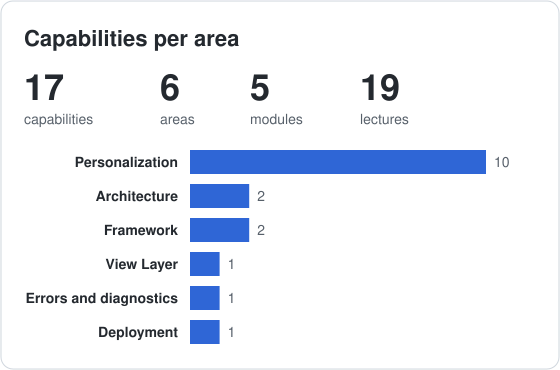
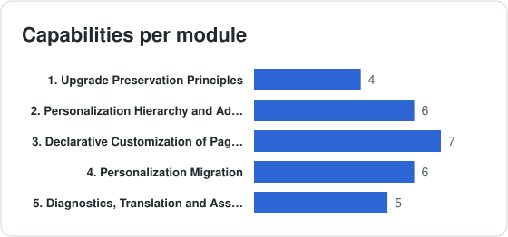

# Oracle OAF Customizing BootCamp 101

**Code:** `OAF-C-101` &nbsp;·&nbsp; **Level:** Beginner

**Curriculum specification only.** Lecture formats and resources describe planned teaching approaches. See the [curriculum conventions](../../../CURRICULUM.md) for scope, difficulty, workload and release applicability.

## Purpose and Audience

Select supported personalizations, explain precedence and plan migration and reversal across environments.

**Audience:** Technical and techno-functional consultants and EBS administrators who need declarative page customization.

## Prerequisites

- Building 101 exit competencies or equivalent OAF vocabulary
- EBS responsibilities, profile options and administrative access concepts

**Readiness check:** Identify a page, region, item and responsibility; explain why hiding a field does not enforce data authorization.

## Course Goals

- Distinguish personalization, extension and modification; predict applicable level precedence.
- Choose supported property and region changes while respecting component and authorization restrictions.
- Specify export, import, environment targeting, validation and back-out of a personalization package.
- Use diagnostic evidence to explain a conflict and defend the personalization assessment decisions.

## Outcomes and Coverage

Required outcomes define the exit competencies. Elective outcomes extend them and carry no compulsory assessment marks.

| Outcome | Path | Modules | Observable capability |
| :-- | :-- | :-- | :-- |
| C101-LO01 | Required | [C101-001](#1-upgrade-preservation-principles-required), [C101-002](#2-personalization-hierarchy-and-administration-required) | Distinguish personalization, extension and modification; predict applicable level precedence. |
| C101-LO02 | Required | [C101-003](#3-declarative-customization-of-pages-regions-and-lovs-required) | Choose supported property and region changes while respecting component and authorization restrictions. |
| C101-LO03 | Required | [C101-004](#4-personalization-migration-required) | Specify export, import, environment targeting, validation and back-out of a personalization package. |
| C101-LO04 | Required | [C101-005](#5-diagnostics-translation-and-assessment-required) | Use diagnostic evidence to explain a conflict and defend the personalization assessment decisions. |
| C101-LOE1 | Elective | [C101-005](#5-diagnostics-translation-and-assessment-required) | Describe XLIFF and language-specific regression requirements for translated personalizations. |

## Learning Path and Workload

Follow the table from top to bottom and skip electives unless their outcomes are needed. Module and lecture IDs are stable references, so their numeric order can differ from the teaching order. The module prerequisites below explain the dependencies.

| Path | Instruction h | Independent study h | Assessment preparation h | Total h |
| :-- | --: | --: | --: | --: |
| Required | 10 | 7 | 6 | 23 |
| Elective additions | 0 | 0 | 0 | 0 |

At **10 hours a week**, the required path is approximately **2.3 weeks**. These are editorial estimates pending pilot data; instruction, study and assessment time are additive and counted once. Alternative project options share the same assessment allowance. Elective extensions inside required modules are excluded from required assessment and from scheduled hours; their additional time is set when selected. Fully elective module hours are shown separately. Conditional product-specific topics are unscheduled until scoped.

**Difficulty:** ★ Beginner · ★★ Elementary · ★★★ Intermediate · ★★★★ Advanced · ★★★★★ Expert. Ratings describe prerequisite depth and reasoning complexity, independently of Video/Lab/Workshop format. Module difficulty represents its central task; individual lectures can differ.

## Curriculum

| Teaching step | Module | Title | Path | Difficulty | Lectures | Instruction h | Study h | Assessment h |
| --: | :-- | :-- | :-- | :-- | --: | --: | --: | --: |
| 1 | C101-001 | [Upgrade Preservation Principles](#1-upgrade-preservation-principles-required) | Required |  | 4 | 1.5 | 1.5 | 0 |
| 2 | C101-002 | [Personalization Hierarchy and Administration](#2-personalization-hierarchy-and-administration-required) | Required |  | 4 | 2 | 1.5 | 0 |
| 3 | C101-003 | [Declarative Customization of Pages, Regions and LOVs](#3-declarative-customization-of-pages-regions-and-lovs-required) | Required |  | 5 | 3 | 2.5 | 0 |
| 4 | C101-004 | [Personalization Migration](#4-personalization-migration-required) | Required |  | 3 | 2 | 1.5 | 0 |
| 5 | C101-005 | [Diagnostics, Translation and Assessment](#5-diagnostics-translation-and-assessment-required) | Required |  | 3 | 1.5 | 0 | 6 |

## Coverage Statistics

The [capability index](../../../capabilities/CAPABILITIES.md) locates planned topics, including electives. Counts do not measure competency or implementation availability.

## [1] Upgrade Preservation Principles (Required)

**Module:** C101-001 | **Difficulty:**  | **Path:** Required

**Prerequisites:** Course entry criteria.

**Module outcome:** Choose personalization versus extension and explain preservation limitations.

| Code | Lecture | Format | Difficulty | Planned resource | Curriculum scope |
| :-- | :-- | :-: | :-- | :-- | :-- |
| C101-001.001 | Comparing Personalization, Extension and Modification | Video |  | Diagram | Personalization, extension, modification; what is supported |
| C101-001.002 | Preserving Personalizations Through Upgrades | Video |  | Diagram | Delta overlays stored separately from base metadata; explain preservation mechanisms and why upgrades still require regression review |
| C101-001.003 | Understanding the MDS Repository Architecture | Video |  | Guide | Repository tables, document paths (`/oracle/apps/...`), XML documents |
| C101-001.004 | Implementing Personalizations in OAF | Video |  | Guide | User-level, admin-level customization, personalization limits |

## [2] Personalization Hierarchy and Administration (Required)

**Module:** C101-002 | **Difficulty:**  | **Path:** Required

**Prerequisites:** [C101-001](#1-upgrade-preservation-principles-required).

**Module outcome:** Predict applicable precedence, enable administration and explain cache effects.

| Code | Lecture | Format | Difficulty | Planned resource | Curriculum scope |
| :-- | :-- | :-: | :-- | :-- | :-- |
| C101-002.001 | Applying Personalization Levels and Precedence | Lab |  | Guide | Function, localization, responsibility, organization or location, site and user levels |
| C101-002.002 | Enabling Personalization | Lab |  | Guide | Personalization profile options, Functional Administrator responsibility |
| C101-002.003 | Clearing MDS Caches | Lab |  | Guide | Functional Administrator cache invalidation, seeing personalization changes immediately |
| C101-002.004 | Resolving Personalization Precedence Across Levels | Lab |  | Guide | User saved views take highest precedence where supported; compare applicable admin levels and component-specific restrictions rather than assume every property supports every level |

## [3] Declarative Customization of Pages, Regions and LOVs (Required)

**Module:** C101-003 | **Difficulty:**  | **Path:** Required

**Prerequisites:** [C101-002](#2-personalization-hierarchy-and-administration-required).

**Module outcome:** Select supported page/region/LOV changes and explain the limits of declarative control.

| Code | Lecture | Format | Difficulty | Planned resource | Curriculum scope |
| :-- | :-- | :-: | :-- | :-- | :-- |
| C101-003.001 | Creating End-User Personalizations | Lab |  | Guide | Personalized views, saved queries, column order, hiding fields |
| C101-003.002 | Applying Declarative Page Personalizations | Lab |  | Project | Show/hide, reorder, labels, required and rendered, defaults, item styles |
| C101-003.003 | Personalizing Flexfields and Tables | Lab |  | Guide | DFF/KFF rendering, row counts, export buttons, accessibility columns |
| C101-003.004 | Injecting Regions Declaratively | Lab |  | Project | Declarative region injection requires Add Indexed Children and an allowed Site, Function or Localization context; supported item styles and BC4J binding restrictions follow Oracle documentation |
| C101-003.005 | Personalizing LOVs | Lab |  | Guide | LOV display and supported criteria personalizations; identify properties that need a supported extension instead; multiselect LOVs are not personalizable |

## [4] Personalization Migration (Required)

**Module:** C101-004 | **Difficulty:**  | **Path:** Required

**Prerequisites:** [C101-003](#3-declarative-customization-of-pages-regions-and-lovs-required).

**Module outcome:** Plan environment-specific export/import, validation and back-out.

| Code | Lecture | Format | Difficulty | Planned resource | Curriculum scope |
| :-- | :-- | :-: | :-- | :-- | :-- |
| C101-004.001 | Exporting Personalizations with XMLExporter | Lab |  | Guide | Extract personalization XML from MDS, migrate between environments with XMLImporter |
| C101-004.002 | Using MDS Management Tools | Lab |  | Guide | Export to file system, XMLImporter import, delete site or user personalizations |
| C101-004.003 | Inspecting MDS Content | Lab |  | Guide | Region map, printing region XML, listing personalizations |

## [5] Diagnostics, Translation and Assessment (Required)

**Module:** C101-005 | **Difficulty:**  | **Path:** Required

**Prerequisites:** [C101-004](#4-personalization-migration-required).

**Module outcome:** Explain diagnostic evidence and defend the required personalization scenario; translation is elective.

| Code | Lecture | Format | Difficulty | Planned resource | Curriculum scope |
| :-- | :-- | :-: | :-- | :-- | :-- |
| C101-005.001 | Using About This Page Diagnostics | Lab |  | Guide | Page context, active personalizations, technology stack, profile options |
| C101-005.002 | Managing Translated Personalizations (Elective) | Video |  | Guide | Elective extension: translated personalizations and XLIFF lifecycle; localization preparation, export/import and language-specific regression review Elective extension: multilingual content; requires translation administration concepts and configured languages. |
| C101-005.003 | Completing the Personalization Project | Workshop |  | Rubric | Curriculum assessment: correctness 35, level targeting and precedence 25, migration and back-out 25, documentation and supportability 15; two levels and a second environment are scenario requirements |

## Assessment Design

**Scenario:** Seeded Page Personalization. One seeded page, at least two supported personalization levels, a precedence conflict, supported property/region changes and promotion/back-out between two environments. Java extensions are outside this course.

This specifies assessment coverage and evidence for future delivery. It does not supply assignments, lab instructions, solution code or a production deployment. Evidence may combine a design explanation, lifecycle trace, scenario analysis and, when a delivered course requires it, an implementation demonstration.

| Criterion | Weight | Outcomes | Expected evidence |
| :-- | --: | :-- | :-- |
| Personalization correctness | 35% | C101-LO01, C101-LO02 | Supported properties and allowed injection/LOV behavior with limitations identified. |
| Targeting and precedence | 25% | C101-LO01 | Two applicable levels, a predicted conflict and the explanation of the effective result. |
| Migration and back-out | 25% | C101-LO03 | Document paths, source/target context, export/import validation and reversal sequence. |
| Supportability and explanation | 15% | C101-LO04 | Diagnostic evidence, change record, regression impact and authorization limitations. |

**Completion threshold:** at least **75/100 overall**, at least **70% within each criterion**, and every critical criterion below satisfied. Optional features cannot replace required evidence.

**Critical criteria:** Personalization is not presented as an authorization mechanism; the level context is correct; the change has an explicit back-out path.

**Scoring anchors:** 0% = absent or incorrect; 50% = partly correct with substantial gaps; 70% = meets the stated requirement with minor gaps; 85% = correct, justified and supported by failure-case reasoning; 100% = complete and precise with convincing trade-off analysis. A failed critical criterion requires revision and reassessment of the affected evidence.

## Exit Competencies and Next Step

Completion means the learner can demonstrate every **Required** outcome above within the stated scenario and assessment threshold. Course titles and completion milestones are provider-defined; they do not confer Oracle certification or establish production competence without supervised delivery experience.

**Next:** Customizing 102 after Building 102 and the Building 103 deployment core.

[BootCamp overview](../../../../README.md) · [Curriculum conventions and references](../../../CURRICULUM.md) · [Roadmap](../../../../roadmap/README.md)
