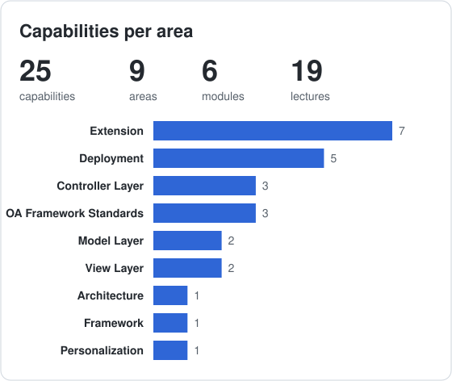
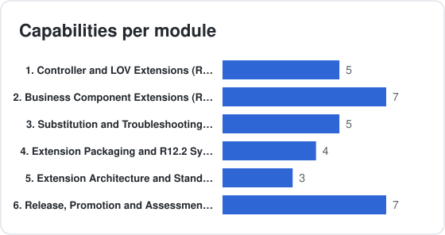

# Oracle OAF Customizing BootCamp 102

**Code:** `OAF-C-102` &nbsp;·&nbsp; **Level:** Advanced

**Curriculum specification only.** Lecture formats and resources describe planned teaching approaches. See the [curriculum conventions](../../../CURRICULUM.md) for scope, difficulty, workload and release applicability.

## Purpose and Audience

Choose supported extension touchpoints and plan BC4J substitution, packaging, diagnosis and reversible promotion.

**Audience:** Developers who maintain seeded OAF extensions and review their release and support impact.

## Prerequisites

- Building 102 required path and Customizing 101 completed, or equivalent competencies
- Building 103 deployment core: B103-001, B103-002, B103-003 and B103-004
- Java subclassing, overriding, super calls and exception analysis

**Readiness check:** Distinguish personalization from extension, trace basic controller lifecycle behavior and explain JPX/MDS packaging plus the R12.2 run/patch distinction.

## Course Goals

- Justify a supported extension touchpoint, namespace, schema placement and upgrade-impact boundary.
- Design model and controller extensions with explicit subclass contracts, super calls and transaction ownership.
- Explain BC4J substitution registration and diagnose definition/classloader resolution failures.
- Specify extension packaging, adop synchronization, promotion, verification and recovery.
- Defend the extension scope and document support assumptions, regression coverage and troubleshooting evidence.

## Outcomes and Coverage

Required outcomes define the exit competencies. Elective outcomes extend them and carry no compulsory assessment marks.

| Outcome | Path | Modules | Observable capability |
| :-- | :-- | :-- | :-- |
| C102-LO01 | Required | [C102-005](#5-extension-architecture-and-standards-required) | Justify a supported extension touchpoint, namespace, schema placement and upgrade-impact boundary. |
| C102-LO02 | Required | [C102-002](#2-business-component-extensions-required), [C102-001](#1-controller-and-lov-extensions-required) | Design model and controller extensions with explicit subclass contracts, super calls and transaction ownership. |
| C102-LO03 | Required | [C102-003](#3-substitution-and-troubleshooting-required) | Explain BC4J substitution registration and diagnose definition/classloader resolution failures. |
| C102-LO04 | Required | [C102-004](#4-extension-packaging-and-r122-synchronization-required), [C102-006](#6-release-promotion-and-assessment-required) | Specify extension packaging, adop synchronization, promotion, verification and recovery. |
| C102-LO05 | Required | [C102-006](#6-release-promotion-and-assessment-required) | Defend the extension scope and document support assumptions, regression coverage and troubleshooting evidence. |

## Learning Path and Workload

Follow the table from top to bottom and skip electives unless their outcomes are needed. Module and lecture IDs are stable references, so their numeric order can differ from the teaching order. The module prerequisites below explain the dependencies.

| Path | Instruction h | Independent study h | Assessment preparation h | Total h |
| :-- | --: | --: | --: | --: |
| Required | 13 | 8.5 | 10 | 31.5 |
| Elective additions | 0 | 0 | 0 | 0 |

At **10 hours a week**, the required path is approximately **3.1 weeks**. These are editorial estimates pending pilot data; instruction, study and assessment time are additive and counted once. Alternative project options share the same assessment allowance. Elective extensions inside required modules are excluded from required assessment and from scheduled hours; their additional time is set when selected. Fully elective module hours are shown separately. Conditional product-specific topics are unscheduled until scoped.

**Difficulty:** ★ Beginner · ★★ Elementary · ★★★ Intermediate · ★★★★ Advanced · ★★★★★ Expert. Ratings describe prerequisite depth and reasoning complexity, independently of Video/Lab/Workshop format. Module difficulty represents its central task; individual lectures can differ.

## Curriculum

| Teaching step | Module | Title | Path | Difficulty | Lectures | Instruction h | Study h | Assessment h |
| --: | :-- | :-- | :-- | :-- | --: | --: | --: | --: |
| 1 | C102-005 | [Extension Architecture and Standards](#5-extension-architecture-and-standards-required) | Required |  | 4 | 2 | 1.5 | 0 |
| 2 | C102-002 | [Business Component Extensions](#2-business-component-extensions-required) | Required |  | 3 | 3 | 2.5 | 0 |
| 3 | C102-001 | [Controller and LOV Extensions](#1-controller-and-lov-extensions-required) | Required |  | 2 | 2 | 1.5 | 0 |
| 4 | C102-003 | [Substitution and Troubleshooting](#3-substitution-and-troubleshooting-required) | Required |  | 3 | 2 | 1.5 | 0 |
| 5 | C102-004 | [Extension Packaging and R12.2 Synchronization](#4-extension-packaging-and-r122-synchronization-required) | Required |  | 3 | 2 | 1.5 | 0 |
| 6 | C102-006 | [Release, Promotion and Assessment](#6-release-promotion-and-assessment-required) | Required |  | 4 | 2 | 0 | 10 |

## Coverage Statistics

The [capability index](../../../capabilities/CAPABILITIES.md) locates planned topics, including electives. Counts do not measure competency or implementation availability.

## [5] Extension Architecture and Standards (Required)

**Module:** C102-005 | **Difficulty:**  | **Path:** Required

**Prerequisites:** Course entry criteria.

**Module outcome:** Evaluate supported touchpoints and schema/package boundaries before extension design.

| Code | Lecture | Format | Difficulty | Planned resource | Curriculum scope |
| :-- | :-- | :-: | :-- | :-- | :-- |
| C102-005.001 | Applying Extension Standards | Video |  | Guide | `xx` prefixes, package structure, extension log |
| C102-005.002 | Choosing Extension Touchpoints | Video |  | Diagram | Compare supported personalization, model extension and controller touchpoints; assess seeded component support boundaries before selecting an extension |
| C102-005.003 | Placing Custom Code | Video |  | Guide | APPS versus custom schema, grants and synonyms under Edition-Based Redefinition |
| C102-005.004 | Evaluating Extension Support and Upgrade Impact | Workshop |  | Patterns | Document target seeded objects, supported hooks, subclass contracts and regression scope; avoid promising every customization is upgrade-safe |

## [2] Business Component Extensions (Required)

**Module:** C102-002 | **Difficulty:**  | **Path:** Required

**Prerequisites:** [C102-005](#5-extension-architecture-and-standards-required).

**Module outcome:** Select VO, EO or AM extensions while preserving model validation and transactions.

| Code | Lecture | Format | Difficulty | Planned resource | Curriculum scope |
| :-- | :-- | :-: | :-- | :-- | :-- |
| C102-002.001 | Extending View Objects | Lab |  | Project | Transient and mapped attributes, SQL changes, bind parameters, query overrides |
| C102-002.002 | Extending Entity Objects | Lab |  | Project | Default values, extra columns, custom validation rules, DML overrides |
| C102-002.003 | Extending Application Modules | Lab |  | Project | Custom transaction methods, nested AM extensions |

## [1] Controller and LOV Extensions (Required)

**Module:** C102-001 | **Difficulty:**  | **Path:** Required

**Prerequisites:** [C102-005](#5-extension-architecture-and-standards-required), [C102-002](#2-business-component-extensions-required).

**Module outcome:** Define controller/LOV subclass contracts and preserve inherited behavior.

| Code | Lecture | Format | Difficulty | Planned resource | Curriculum scope |
| :-- | :-- | :-: | :-- | :-- | :-- |
| C102-001.001 | Extending Controllers | Lab |  | Project | Extending `processRequest` and `processFormRequest`, super calls, attaching through personalization |
| C102-001.002 | Extending LOVs Programmatically | Lab |  | Project | LOV controller extensions, VO substitution for LOV queries |

## [3] Substitution and Troubleshooting (Required)

**Module:** C102-003 | **Difficulty:**  | **Path:** Required

**Prerequisites:** [C102-001](#1-controller-and-lov-extensions-required), [C102-002](#2-business-component-extensions-required).

**Module outcome:** Explain JPX substitution resolution and diagnose runtime failures.

| Code | Lecture | Format | Difficulty | Planned resource | Curriculum scope |
| :-- | :-- | :-: | :-- | :-- | :-- |
| C102-003.001 | Understanding the Substitution Mechanism | Video |  | Diagram | BC4J definition substitutions registered through JPX metadata; distinguish model substitution from controller attachment through personalization |
| C102-003.002 | Deploying Substitutions | Lab |  | Guide | JPX project substitution mappings and JPXImporter registration; verify active definitions and scope; generic deployment tooling is a B103 prerequisite |
| C102-003.003 | Troubleshooting Extensions | Lab |  | Checklist | Classloader conflicts, substitution load failures, casting exceptions |

## [4] Extension Packaging and R12.2 Synchronization (Required)

**Module:** C102-004 | **Difficulty:**  | **Path:** Required

**Prerequisites:** [C102-003](#3-substitution-and-troubleshooting-required).

**Module outcome:** Plan extension artifacts, archive generation and run/patch synchronization.

| Code | Lecture | Format | Difficulty | Planned resource | Curriculum scope |
| :-- | :-- | :-: | :-- | :-- | :-- |
| C102-004.001 | Packaging Archives with adcgnjar | Lab |  | Guide | $AD_TOP/bin/adcgnjar, customall.jar, manifest files, signed archives; applies the Dev 103 tooling to extensions |
| C102-004.002 | Packaging Extensions for Deployment | Lab |  | Guide | Classes, XML pages and MDS documents under `$JAVA_TOP`; extension-specific steps, tooling basics are in Dev 103 |
| C102-004.003 | Synchronizing the R12.2 File Systems | Lab |  | Guide | adop cycle, run/patch editions and custom synchronization driver adop_sync_drv.txt; distinguish the supplied adop_sync_drv.tmp template |

## [6] Release, Promotion and Assessment (Required)

**Module:** C102-006 | **Difficulty:**  | **Path:** Required

**Prerequisites:** [C102-004](#4-extension-packaging-and-r122-synchronization-required).

**Module outcome:** Review promotion, negative access, recovery and assessment evidence.

| Code | Lecture | Format | Difficulty | Planned resource | Curriculum scope |
| :-- | :-- | :-: | :-- | :-- | :-- |
| C102-006.001 | Using Import Tools | Lab |  | Guide | XMLImporter for pages and regions, attribute sets |
| C102-006.002 | Registering Functions and Menus | Lab |  | Guide | Register functions, attach to menus, assign responsibilities |
| C102-006.003 | Promoting Customizations Between Environments | Video |  | Guide | Dev, test and production migration, patching, version control, verification and rollback |
| C102-006.004 | Completing the Extension Project | Workshop |  | Rubric | Curriculum assessment: extension design 30, substitution and runtime resolution 25, packaging and recovery 25, troubleshooting 10, supportability documentation 10; see Assessment Design |

## Assessment Design

**Scenario:** Seeded Page Extension and Release Plan. One supported seeded-page scenario with a justified model substitution and controller extension, runtime-resolution analysis, release manifest, synchronization and recovery plan. Identify product-specific support boundaries; an extension cannot promise upgrade compatibility without review.

This specifies assessment coverage and evidence for future delivery. It does not supply assignments, lab instructions, solution code or a production deployment. Evidence may combine a design explanation, lifecycle trace, scenario analysis and, when a delivered course requires it, an implementation demonstration.

| Criterion | Weight | Outcomes | Expected evidence |
| :-- | --: | :-- | :-- |
| Extension design | 30% | C102-LO01, C102-LO02 | Supported touchpoint choice, subclass contract, super calls and transaction ownership. |
| Substitution and runtime resolution | 25% | C102-LO03 | JPX mappings, expected active definition and classloader/substitution failure analysis. |
| Packaging and recovery | 25% | C102-LO04 | Artifact manifest, adcgnjar role, synchronization, environment promotion and reversal. |
| Troubleshooting | 10% | C102-LO03, C102-LO05 | Evidence-based analysis of a substitution or class-resolution failure. |
| Supportability documentation | 10% | C102-LO01, C102-LO05 | Seeded-object inventory, release assumptions, regression scope and design defense. |

**Completion threshold:** at least **80/100 overall**, at least **70% within each criterion**, and every critical criterion below satisfied. Optional features cannot replace required evidence.

**Critical criteria:** Inherited behavior and authorization are preserved; active substitutions can be identified; synchronization and recovery are explicitly specified.

**Scoring anchors:** 0% = absent or incorrect; 50% = partly correct with substantial gaps; 70% = meets the stated requirement with minor gaps; 85% = correct, justified and supported by failure-case reasoning; 100% = complete and precise with convincing trade-off analysis. A failed critical criterion requires revision and reassessment of the affected evidence.

## Exit Competencies and Next Step

Completion means the learner can demonstrate every **Required** outcome above within the stated scenario and assessment threshold. Course titles and completion milestones are provider-defined; they do not confer Oracle certification or establish production competence without supervised delivery experience.

**Next:** Maintain an extension inventory and conduct supervised change-impact and upgrade reviews.

[BootCamp overview](../../../../README.md) · [Curriculum conventions and references](../../../CURRICULUM.md) · [Roadmap](../../../../roadmap/README.md)
