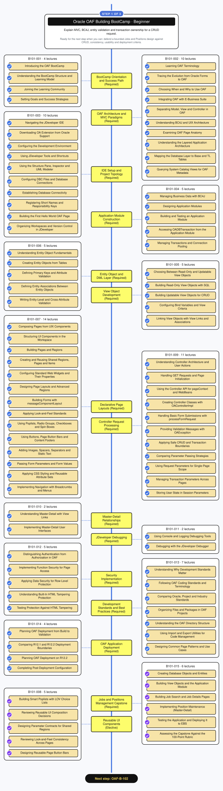
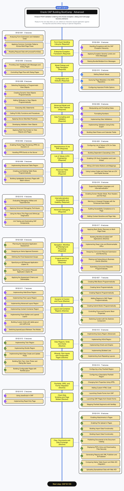
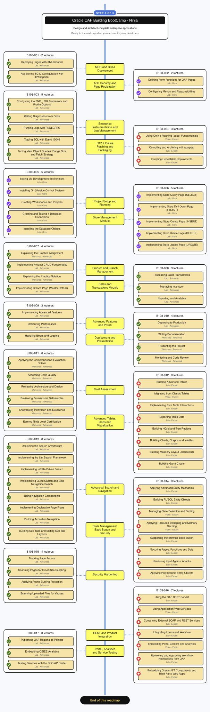
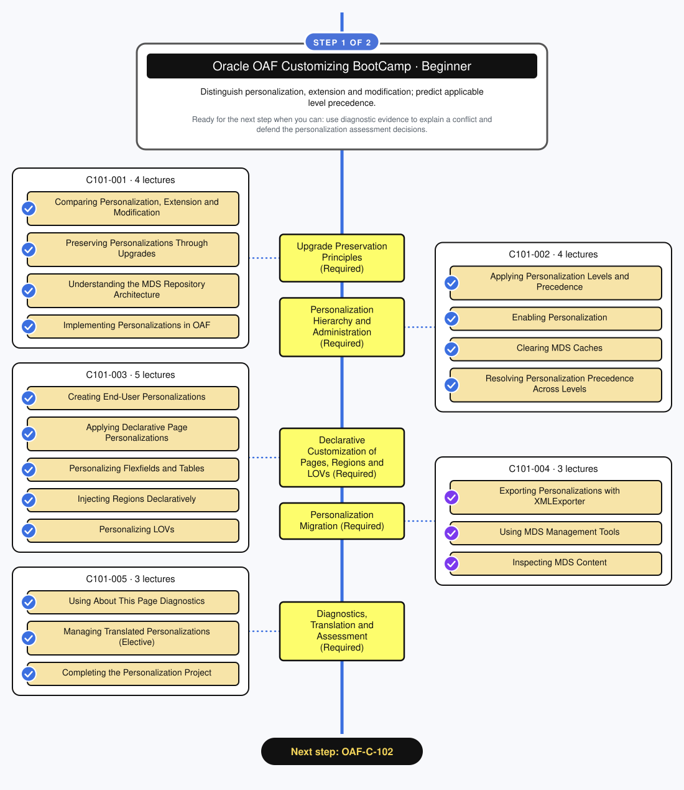
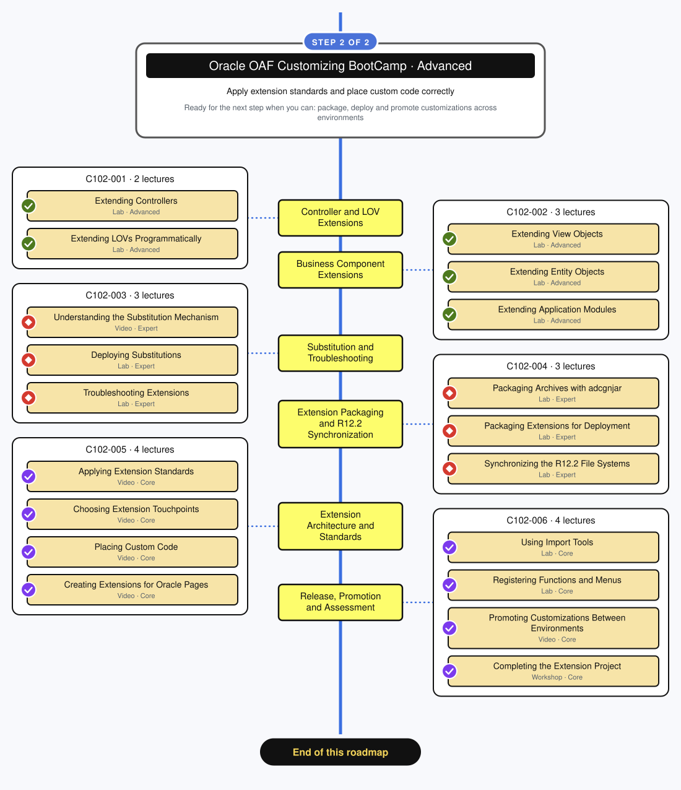

# Oracle Application Framework (OAF) Roadmap

Two learning paths for Oracle E-Business Suite OAF developers. **Building** takes you from your first page to production. **Customizing** shows you how to change delivered pages without breaking upgrades. Every step is one course of the [Oracle OAF BootCamp](../README.md), with its sections, lectures and levels.

 

## Contents

- [How to read the roadmap](#how-to-read-the-roadmap)
- [Building roadmap](#building-roadmap)
  - [Step 1: Oracle OAF Building BootCamp 101](#step-1-oracle-oaf-building-bootcamp-101)
  - [Step 2: Oracle OAF Building BootCamp 102](#step-2-oracle-oaf-building-bootcamp-102)
  - [Step 3: Oracle OAF Building BootCamp 103](#step-3-oracle-oaf-building-bootcamp-103)
- [Customizing roadmap](#customizing-roadmap)
  - [Step 1: Oracle OAF Customizing BootCamp 101](#step-1-oracle-oaf-customizing-bootcamp-101)
  - [Step 2: Oracle OAF Customizing BootCamp 102](#step-2-oracle-oaf-customizing-bootcamp-102)

 

## How to read the roadmap

 

## Building Roadmap

**Path:** Beginner → Advanced → Ninja

Build OAF pages, business components and applications, from the first page to production.

| Step | Course | Level | Sections | Lectures | Focus |
| --: | :-- | :-: | :-: | :-: | :-- |
| 1 | [OAF-B-101](#step-1-oracle-oaf-building-bootcamp-101) | Beginner | 15 | 92 | Architecture, MVC, JDeveloper setup, application modules, view and entity objects, pages, controllers, master-detail, debugging, security, deployment and a capstone |
| 2 | [OAF-B-102](#step-2-oracle-oaf-building-bootcamp-102) | Advanced | 20 | 97 | Event handling, PPR, LOVs, exception framework, dialogs, advanced tables, flexfields, scripting, internationalization and advanced debugging |
| 3 | [OAF-B-103](#step-3-oracle-oaf-building-bootcamp-103) | Ninja | 17 | 80 | MDS and BC4J deployment, AOL security, instrumentation, R12.2 online patching, REST integration and a point-of-sale capstone |

 

### Step 1: Oracle OAF Building BootCamp 101

Step 1 of 3 · Beginner · [OAF-B-101 course](../bootcamp/courses/building/101/README.md) · 15 sections · 92 lectures

Topics as text

- **B101-001 BootCamp Orientation and Success Path** (Difficulty ★)
  - Introducing the OAF BootCamp (Video, Foundation)
  - Understanding the BootCamp Structure and Learning Model (Video, Foundation)
  - Joining the Learning Community (Video, Foundation)
  - Setting Goals and Success Strategies (Workshop, Foundation)
- **B101-002 OAF Architecture and MVC Paradigms** (Difficulty ★)
  - Learning OAF Terminology (Video, Foundation)
  - Tracing the Evolution from Oracle Forms to OAF (Video, Foundation)
  - Choosing When and Why to Use OAF (Video, Foundation)
  - Integrating OAF with E-Business Suite (Video, Foundation)
  - Separating Model, View and Controller in OAF (Video, Foundation)
  - Understanding BC4J and UIX Architecture (Video, Foundation)
  - Examining OAF Page Anatomy (Video, Foundation)
  - Understanding the Layered Application Architecture (Video, Foundation)
  - Mapping the Database Layer to Base and TL Tables (Video, Foundation)
  - Querying System Catalog Views for OAF Metadata (Video, Foundation)
- **B101-003 IDE Setup and Project Topology** (Difficulty ★)
  - Navigating the JDeveloper IDE (Video, Foundation)
  - Downloading OA Extension from Oracle Support (Video, Foundation)
  - Configuring the Development Environment (Video, Foundation)
  - Using JDeveloper Tools and Shortcuts (Video, Foundation)
  - Using the Structure Pane, Inspector and UML Modeler (Lab, Foundation)
  - Configuring DBC Files and Database Connections (Video, Foundation)
  - Establishing Database Connectivity (Video, Foundation)
  - Registering Short Names and Responsibility Keys (Lab, Foundation)
  - Building the First Hello World OAF Page (Lab, Foundation)
  - Organizing Workspaces and Version Control in JDeveloper (Video, Foundation)
- **B101-004 Application Module Construction** (Difficulty ★)
  - Managing Business Data with BC4J (Video, Foundation)
  - Designing Application Modules (Video, Foundation)
  - Building and Testing an Application Module (Lab, Foundation)
  - Accessing OADBTransaction from the Application Module (Lab, Foundation)
  - Managing Transactions and Connection Pooling (Video, Foundation)
- **B101-005 View Object Development** (Difficulty ★★)
  - Choosing Between Read-Only and Updatable View Objects (Video, Foundation)
  - Building Updatable View Objects for CRUD (Lab, Foundation)
  - Building Read-Only View Objects with SQL (Lab, Foundation)
  - Configuring Bind Variables and View Criteria (Lab, Foundation)
  - Linking View Objects with View Links and Associations (Video, Foundation)
- **B101-006 Entity Object and DML Layer** (Difficulty ★★)
  - Understanding Entity Object Fundamentals (Video, Foundation)
  - Creating Entity Objects from Tables (Lab, Foundation)
  - Defining Primary Keys and Attribute Validation (Lab, Foundation)
  - Defining Entity Associations Between Entity Objects (Lab, Foundation)
  - Writing Entity-Level and Cross-Attribute Validation (Lab, Foundation)
- **B101-007 Declarative Page Layouts** (Difficulty ★)
  - Composing Pages from UIX Components (Video, Foundation)
  - Structuring UI Components in the Workspace (Video, Foundation)
  - Building Pages and Regions (Video, Foundation)
  - Creating and Reusing Shared Regions, Pages and Items (Lab, Foundation)
  - Configuring Standard Web Widgets and Their Properties (Lab, Foundation)
  - Designing Page Layouts and Advanced Regions (Lab, Foundation)
  - Building Forms with messageComponentLayout (Lab, Foundation)
  - Applying Look-and-Feel Standards (Video, Foundation)
  - Using Poplists, Radio Groups, Checkboxes and Spin Boxes (Lab, Foundation)
  - Using Buttons, Page Button Bars and Content Footers (Lab, Foundation)
  - Adding Images, Spacers, Separators and Static Text (Lab, Foundation)
  - Passing Form Parameters and Form Values (Lab, Foundation)
  - Applying CSS Styling and Reusable Attribute Sets (Video, Foundation)
  - Implementing Navigation with Breadcrumbs and Menus (Video, Foundation)
- **B101-008 Reusable UI Components** (Difficulty ★★)
  - Building Smart Poplists with LOV Choice Lists (Lab, Foundation)
  - Spacing Layouts with Spacers, Separators and Images (Lab, Foundation)
  - Passing Form Parameters Between Pages (Lab, Foundation)
  - Applying a Look and Feel to a Page (Lab, Foundation)
  - Adding Page Button Bars to Forms (Lab, Foundation)
- **B101-009 Controller Request Processing** (Difficulty ★★)
  - Understanding Controller Architecture and User Actions (Video, Foundation)
  - Handling GET Requests and Page Initialization (Video, Foundation)
  - Using the Controller API for pageContext and WebBeans (Video, Foundation)
  - Comparing Parameter Passing Strategies (Video, Foundation)
  - Using Request Parameters for Single-Page Scope (Lab, Foundation)
  - Managing Transaction Parameters Across Pages (Lab, Foundation)
  - Storing User State in Session Parameters (Lab, Foundation)
  - Creating Controller Classes with OAControllerImpl (Lab, Foundation)
- **B101-010 Master-Detail Relationships** (Difficulty ★★)
  - Understanding Master-Detail with View Links (Video, Foundation)
  - Implementing Master-Detail User Interfaces (Lab, Foundation)
- **B101-011 JDeveloper Debugging** (Difficulty ★)
  - Using Console and Logging Debugging Tools (Video, Foundation)
  - Debugging with the JDeveloper Debugger (Lab, Foundation)
- **B101-012 Security Implementation** (Difficulty ★★)
  - Distinguishing Authentication from Authorization in OAF (Video, Foundation)
  - Implementing Function Security for Page Access (Lab, Foundation)
  - Applying Data Security for Row-Level Protection (Video, Foundation)
  - Understanding Built-In HTML Tampering Protection (Video, Foundation)
  - Testing Protection Against HTML Tampering (Lab, Foundation)
- **B101-013 Development Standards and Best Practices** (Difficulty ★)
  - Understanding Why Development Standards Matter (Video, Foundation)
  - Following OAF Coding Standards and Terminology (Video, Foundation)
  - Comparing Oracle, Project and Industry Standards (Video, Foundation)
  - Organizing Files and Packages in OAF Projects (Video, Foundation)
  - Understanding the OAF Directory Structure (Video, Foundation)
  - Using Import and Export Utilities for Code Management (Lab, Foundation)
  - Designing Common Page Patterns and Use Cases (Video, Foundation)
- **B101-014 OAF Application Deployment** (Difficulty ★★)
  - Following the OAF Deployment Steps from Build to Bounce (Video, Foundation)
  - Deploying an OAF Application on R12.1.x (Lab, Foundation)
  - Deploying an OAF Application on R12.2.x (Lab, Foundation)
  - Completing Post-Deployment Configuration (Lab, Foundation)
- **B101-015 Jobs and Positions Management Capstone** (Difficulty ★★)
  - Creating Database Objects and Entities (Lab, Foundation)
  - Building View Objects and the Application Module (Lab, Foundation)
  - Building Job Search and Job Details Pages (Lab, Foundation)
  - Implementing Position Maintenance (Master-Detail) (Lab, Foundation)
  - Testing the Application and Deploying It to EBS (Lab, Foundation)
  - Assessing the Capstone Against the 100-Point Rubric (Workshop, Foundation)

 

### Step 2: Oracle OAF Building BootCamp 102

Step 2 of 3 · Advanced · [OAF-B-102 course](../bootcamp/courses/building/102/README.md) · 20 sections · 97 lectures

Topics as text

- **B102-001 Form Event Handling Lifecycle** (Difficulty ★★★)
  - Handling Form Submissions with processFormRequest (Video, Core)
  - Applying Common Controller Patterns (Video, Core)
  - Reading Request Data with processFormData (Lab, Core)
- **B102-002 Asynchronous UI via PPR** (Difficulty ★★★)
  - Enabling Partial Page Rendering (PPR) for Dynamic UI (Lab, Core)
  - Handling PPR Events on the Server (Lab, Core)
- **B102-003 List of Values (LOV) Engineering** (Difficulty ★★★)
  - Configuring List of Values (LOV) for Data Selection (Lab, Core)
  - Building Dependent (Cascading) LOVs (Lab, Core)
  - Enabling LOV Auto-Completion and Look-Ahead (Lab, Core)
  - Wiring LOV Action Buttons and Mappings (Lab, Core)
  - Using Lookup Codes and Value Sets as LOV and Poplist Sources (Lab, Core)
- **B102-004 Enterprise Exception Framework** (Difficulty ★★★)
  - Handling Exceptions with the OAF Exception Hierarchy (Video, Core)
  - Applying Exception Severity Levels and Inline Messages (Lab, Core)
  - Raising Bundle/Multiple Error Messages (Lab, Core)
- **B102-005 Modal Dialogs and Page Navigation** (Difficulty ★★★)
  - Providing User Feedback with Messages and Dialog Pages (Video, Core)
  - Controlling Page Flow with Dialog Pages (Lab, Core)
- **B102-006 Advanced Table Operations** (Difficulty ★★★★)
  - Implementing Advanced Table Region (Lab, Advanced)
  - Creating and Deleting Table Rows Programmatically (Lab, Advanced)
  - Building Updateable Summary Pages with Batch Actions (Lab, Advanced)
- **B102-007 Dynamic UI Control and Focus** (Difficulty ★★★★)
  - Creating Web Beans Programmatically (Lab, Advanced)
  - Creating Items Programmatically (Lab, Advanced)
  - Creating Regions Programmatically (Lab, Advanced)
  - Adding Regions to OAF Pages Programmatically (Lab, Advanced)
  - Creating Submit Button Programmatically (Lab, Advanced)
  - Controlling Focus and Dynamic Bean Properties (Lab, Advanced)
  - Switching Content with the Switcher Component (Lab, Advanced)
- **B102-008 Advanced Model and Server-Side Features** (Difficulty ★★★★)
  - Developing Programmatic View Objects Dynamically (Lab, Advanced)
  - Creating Dynamic View Objects Programmatically (Lab, Advanced)
  - Adding Attributes to View Objects Programmatically (Lab, Advanced)
  - Executing SQL Statements (Lab, Advanced)
  - Calling PL/SQL Functions and Procedures (Lab, Advanced)
  - Applying Server-Side Best Practices (Video, Advanced)
  - Developing Validation View Objects (Lab, Advanced)
  - Applying Multi-Org Context to View Objects and Pages (Lab, Advanced)
- **B102-009 Data Formatting and Validation** (Difficulty ★★★)
  - Manipulating and Formatting Dates (Lab, Core)
  - Formatting Numbers (Lab, Core)
  - Implementing Data Validations (Lab, Core)
  - Implementing Validation Using Entity Expert (Lab, Core)
  - Building Date Pickers and Calendar Fields (Lab, Core)
- **B102-010 Configuration and Defaults** (Difficulty ★★)
  - Setting Default Values (Lab, Foundation)
  - Querying Page Metadata in the MDS Repository (Video, Foundation)
  - Configuring Important Profile Options (Video, Foundation)
- **B102-011 Layout and Container Regions** (Difficulty ★★★)
  - Implementing Hide/Show Region (Lab, Core)
  - Implementing Flow Layout Region (Lab, Core)
  - Implementing Advanced Layout Region (Lab, Core)
  - Implementing Content Container Region (Lab, Core)
  - Implementing Panel Splitter and Layered Layout (Lab, Core)
  - Building Custom Grids with tableLayout and cellFormat (Lab, Core)
  - Switching layeredLayout Between Two Modes (Lab, Core)
- **B102-012 Data Regions, Grids and Charts** (Difficulty ★★★★)
  - Implementing Query Region (Advanced) (Lab, Advanced)
  - Implementing HGrid Region (Lab, Advanced)
  - Implementing Charts and Graphs (Lab, Advanced)
  - Implementing Bulleted Lists (Lab, Advanced)
  - Implementing Auto-Repeating Layouts (Lab, Advanced)
- **B102-013 Wizards, Rich Inputs and Configurable Pages** (Difficulty ★★★★)
  - Implementing Train Region (Lab, Advanced)
  - Implementing Shuttle Region (Lab, Advanced)
  - Implementing Multi-Step Create and Update Flows (Lab, Advanced)
  - Building Rich Text, Color Picker and Rating Bar Inputs (Lab, Advanced)
  - Building Configurable Pages with flexibleLayout (Lab, Advanced)
- **B102-014 Flexfields, SPEL and Forms Integration** (Difficulty ★★★★)
  - Configuring a Key Flexfield Region (Lab, Advanced)
  - Configuring a Descriptive Flexfield Region (Lab, Advanced)
  - Changing Item Properties Using SPEL (Lab, Advanced)
  - Adding Custom HTML Code (Lab, Advanced)
  - Launching Oracle Forms from OAF (Lab, Advanced)
  - Launching OAF Pages from Oracle Forms (Lab, Advanced)
  - Mapping Flexfield Segments with flexMap (Lab, Advanced)
- **B102-015 Client-Side Scripting and Page Modes** (Difficulty ★★★)
  - Using JavaScript in OAF (Lab, Core)
  - Implementing Read-Only Page (Lab, Core)
- **B102-016 Files, Documents and Data Exchange** (Difficulty ★★★)
  - Enabling Attachments in Pages (Lab, Core)
  - Enabling File Upload in Pages (Lab, Core)
  - Building Import Data Functionality (Lab, Core)
  - Building Export Data Functionality (Lab, Core)
  - Publishing Documents to the Document Catalog (Lab, Core)
  - Displaying PDFs Inline and Downloading Files Securely (Lab, Core)
  - Generating Reports with XML Publisher and BI Publisher (Lab, Core)
  - Enabling Web ADI Table Export (Lab, Core)
  - Uploading Spreadsheet Data with Web ADI (Lab, Core)
- **B102-017 Navigation, Workflow and Background Processing** (Difficulty ★★★★)
  - Handling Browser Back Button (Lab, Advanced)
  - Building Workflow-Enabled OAF Applications (Lab, Advanced)
  - Implementing Deep Links and Bookmarkable URLs (Lab, Advanced)
  - Submitting Concurrent Requests from OAF Pages (Lab, Advanced)
  - Raising and Subscribing to Business Events (Lab, Advanced)
  - Submitting Concurrent Requests Programmatically (Lab, Advanced)
- **B102-018 Internationalization, Accessibility and Usability** (Difficulty ★★★)
  - Supporting Multiple Languages and Internationalization (Lab, Core)
  - Enabling Screen Reader Mode, Row Headers and Hot Keys (Lab, Core)
  - Warning on Unsaved Changes with the Enhanced Save Model (Lab, Core)
  - Auditing Accessibility Compliance of a Page (Lab, Core)
  - Adding Context-Sensitive and Page Help (Video, Core)
- **B102-019 Advanced Debugging** (Difficulty ★★★★)
  - Using demasy-oaf Libraries for Debugging (Lab, Advanced)
  - Applying Advanced Debugging Techniques (Lab, Advanced)
  - Using the About This Page and OAInfo.jsp Diagnostics (Lab, Advanced)
  - Unit Testing and Automating OAF Components (Video, Advanced)
- **B102-020 Projects and Final Assessment** (Difficulty ★★★★)
  - Kicking Off and Planning Project 101 (Workshop, Advanced)
  - Building Project 102 for Items with an Approval Cycle (Lab, Advanced)
  - Selecting the Final Assessment Project (Workshop, Advanced)
  - Building the Advanced HR Management System (Option A) (Lab, Advanced)
  - Building the Procurement Request System (Option B) (Lab, Advanced)
  - Applying the Assessment Criteria and Deliverables (Workshop, Advanced)

 

### Step 3: Oracle OAF Building BootCamp 103

Step 3 of 3 · Ninja · [OAF-B-103 course](../bootcamp/courses/building/103/README.md) · 17 sections · 80 lectures

Topics as text

- **B103-001 MDS and BC4J Deployment** (Difficulty ★★★★)
  - Deploying Pages with XMLImporter (Lab, Advanced)
  - Registering BC4J Configuration with JPXImporter (Lab, Advanced)
- **B103-002 AOL Security and Page Registration** (Difficulty ★★★)
  - Defining Form Functions for OAF Pages (Lab, Core)
  - Configuring Menus and Responsibilities (Lab, Core)
- **B103-003 Enterprise Instrumentation and Log Management** (Difficulty ★★★★)
  - Configuring the FND_LOG Framework and Profile Options (Lab, Advanced)
  - Writing Diagnostics from Code (Lab, Advanced)
  - Purging Logs with FNDLGPRG (Lab, Advanced)
  - Tracing SQL with Event 10046 (Lab, Advanced)
  - Tuning View Object Queries: Range Size and Fetch Strategy (Lab, Advanced)
- **B103-004 R12.2 Online Patching and Packaging** (Difficulty ★★★★★)
  - Using Online Patching (adop) Fundamentals (Video, Expert)
  - Compiling and Archiving with adcgnjar (Lab, Expert)
  - Scripting Repeatable Deployments (Lab, Expert)
- **B103-005 Project Setup and Planning** (Difficulty ★★★)
  - Setting-Up Development Environment (Lab, Core)
  - Installing Git (Version Control System) (Lab, Core)
  - Creating Workspaces and Projects (Lab, Core)
  - Creating and Testing a Database Connection (Lab, Core)
  - Installing the Database Objects (Lab, Core)
- **B103-006 Store Management Module** (Difficulty ★★★)
  - Implementing Store Query Page (SELECT) (Lab, Core)
  - Implementing Store Drill-Down Page (SELECT) (Lab, Core)
  - Implementing Store Create Page (INSERT) (Lab, Core)
  - Implementing Store Delete Page (DELETE) (Lab, Core)
  - Implementing Store Update Page (UPDATE) (Lab, Core)
- **B103-007 Product and Branch Management** (Difficulty ★★★★)
  - Explaining the Practice Assignment (Workshop, Advanced)
  - Implementing Product CRUD Functionality (Lab, Advanced)
  - Explaining the Practice Solution (Workshop, Advanced)
  - Implementing Branch Page (Master-Details) (Lab, Advanced)
- **B103-008 Sales and Transactions Module** (Difficulty ★★★★)
  - Processing Sales Transactions (Lab, Advanced)
  - Managing Inventory (Lab, Advanced)
  - Reporting and Analytics (Lab, Advanced)
- **B103-009 Advanced Features and Polish** (Difficulty ★★★★)
  - Implementing Advanced Features (Lab, Advanced)
  - Optimizing Performance (Lab, Advanced)
  - Handling Errors and Logging (Lab, Advanced)
- **B103-010 Deployment and Presentation** (Difficulty ★★★★)
  - Deploying to Production (Lab, Advanced)
  - Writing Documentation (Workshop, Advanced)
  - Presenting the Project (Workshop, Advanced)
  - Mentoring and Code Review (Workshop, Advanced)
- **B103-011 Final Assessment** (Difficulty ★★★★)
  - Applying the Comprehensive Evaluation Criteria (Workshop, Advanced)
  - Assessing Code Quality (Workshop, Advanced)
  - Reviewing Architecture and Design (Workshop, Advanced)
  - Reviewing Professional Deliverables (Workshop, Advanced)
  - Showcasing Innovation and Excellence (Workshop, Advanced)
  - Earning Ninja Level Certification (Workshop, Advanced)
- **B103-012 Advanced Tables, Grids and Visualization** (Difficulty ★★★★★)
  - Building Advanced Tables (Lab, Expert)
  - Migrating from Classic Tables (Video, Expert)
  - Implementing Rich Table Interactions (Lab, Expert)
  - Exporting Table Data (Lab, Expert)
  - Building HGrid and Tree Regions (Lab, Expert)
  - Building Charts, Graphs and Infotiles (Lab, Expert)
  - Building Masonry Layout Dashboards (Lab, Expert)
  - Building Gantt Charts (Lab, Expert)
- **B103-013 Advanced Search and Navigation** (Difficulty ★★★★)
  - Designing the Search Architecture (Lab, Advanced)
  - Implementing the List Search Framework (Lab, Advanced)
  - Implementing Infotile-Driven Search (Lab, Advanced)
  - Implementing Quick Search and Side Navigation Search (Lab, Advanced)
  - Using Navigation Components (Lab, Advanced)
  - Implementing Declarative Page Flows (Lab, Advanced)
  - Building Accordion Navigation (Lab, Advanced)
  - Building Sub Tabs and Sliding Sub Tab Layouts (Lab, Advanced)
- **B103-014 State Management, Back Button and Security** (Difficulty ★★★★★)
  - Applying Advanced Entity Mechanics (Lab, Expert)
  - Building PL/SQL Entity Objects (Lab, Expert)
  - Managing State Retention and Pooling (Video, Expert)
  - Applying Resource Swapping and Memory Caching (Video, Expert)
  - Supporting the Browser Back Button (Lab, Expert)
  - Securing Pages, Functions and Data (Lab, Expert)
  - Hardening Input Against Attacks (Lab, Expert)
  - Applying Polymorphic Entity Objects (Lab, Expert)
- **B103-015 Security Hardening** (Difficulty ★★★★)
  - Tracking Page Access (Lab, Advanced)
  - Scanning Pages for Cross-Site Scripting (Lab, Advanced)
  - Applying Frame Busting Protection (Lab, Advanced)
  - Scanning Uploaded Files for Viruses (Lab, Advanced)
- **B103-016 REST and Product Integration** (Difficulty ★★★★★)
  - Using the OAF REST Servlet (Lab, Expert)
  - Using Application Web Services (Video, Expert)
  - Consuming External SOAP and REST Services (Lab, Expert)
  - Integrating Forms and Workflow (Lab, Expert)
  - Embedding Portal Content and Analytics (Video, Expert)
  - Reviewing and Approving Workflow Notifications from OAF (Lab, Expert)
  - Embedding Oracle JET Components and Third-Party Web Apps (Lab, Expert)
- **B103-017 Portal, Analytics and Service Testing** (Difficulty ★★★★)
  - Publishing OAF Regions as Portlets (Lab, Advanced)
  - Embedding OBIEE Analytics (Lab, Advanced)
  - Testing Services with the BSO API Tester (Lab, Advanced)

 

## Customizing Roadmap

**Path:** Beginner → Advanced

Personalize and extend delivered Oracle E-Business Suite pages without breaking upgrades. Customizing 101 follows Building 101, and Customizing 102 follows Building 102.

| Step | Course | Level | Sections | Lectures | Focus |
| --: | :-- | :-: | :-: | :-: | :-- |
| 1 | [OAF-C-101](#step-1-oracle-oaf-customizing-bootcamp-101) | Beginner | 5 | 19 | Personalization hierarchy, declarative customization of pages, regions and LOVs, migration and diagnostics |
| 2 | [OAF-C-102](#step-2-oracle-oaf-customizing-bootcamp-102) | Advanced | 6 | 19 | Controller, LOV and business component extensions, substitution, packaging and R12.2 synchronization |

 

### Step 1: Oracle OAF Customizing BootCamp 101

Step 1 of 2 · Beginner · [OAF-C-101 course](../bootcamp/courses/customizing/101/README.md) · 5 sections · 19 lectures

Topics as text

- **C101-001 Upgrade Preservation Principles** (Difficulty ★★)
  - Comparing Personalization, Extension and Modification (Video, Foundation)
  - Preserving Personalizations Through Upgrades (Video, Foundation)
  - Understanding the MDS Repository Architecture (Video, Foundation)
  - Implementing Personalizations in OAF (Video, Foundation)
- **C101-002 Personalization Hierarchy and Administration** (Difficulty ★★★)
  - Applying Personalization Levels and Precedence (Lab, Core)
  - Enabling Personalization (Lab, Core)
  - Clearing MDS Caches (Lab, Core)
  - Resolving Personalization Precedence Across Levels (Lab, Core)
- **C101-003 Declarative Customization of Pages, Regions and LOVs** (Difficulty ★★★)
  - Creating End-User Personalizations (Lab, Core)
  - Applying Declarative Page Personalizations (Lab, Core)
  - Personalizing Flexfields and Tables (Lab, Core)
  - Injecting Regions Declaratively (Lab, Core)
  - Personalizing LOVs (Lab, Core)
- **C101-004 Personalization Migration** (Difficulty ★★★)
  - Exporting Personalizations with XMLExporter (Lab, Core)
  - Using MDS Management Tools (Lab, Core)
  - Inspecting MDS Content (Lab, Core)
- **C101-005 Diagnostics, Translation and Assessment** (Difficulty ★★★)
  - Using About This Page Diagnostics (Lab, Core)
  - Managing Translated Personalizations (Video, Core)
  - Completing the Personalization Project (Workshop, Core)

 

### Step 2: Oracle OAF Customizing BootCamp 102

Step 2 of 2 · Advanced · [OAF-C-102 course](../bootcamp/courses/customizing/102/README.md) · 6 sections · 19 lectures

Topics as text

- **C102-001 Controller and LOV Extensions** (Difficulty ★★★★)
  - Extending Controllers (Lab, Advanced)
  - Extending LOVs Programmatically (Lab, Advanced)
- **C102-002 Business Component Extensions** (Difficulty ★★★★)
  - Extending View Objects (Lab, Advanced)
  - Extending Entity Objects (Lab, Advanced)
  - Extending Application Modules (Lab, Advanced)
- **C102-003 Substitution and Troubleshooting** (Difficulty ★★★★★)
  - Understanding the Substitution Mechanism (Video, Expert)
  - Deploying Substitutions (Lab, Expert)
  - Troubleshooting Extensions (Lab, Expert)
- **C102-004 Extension Packaging and R12.2 Synchronization** (Difficulty ★★★★★)
  - Packaging Archives with adcgnjar (Lab, Expert)
  - Packaging Extensions for Deployment (Lab, Expert)
  - Synchronizing the R12.2 File Systems (Lab, Expert)
- **C102-005 Extension Architecture and Standards** (Difficulty ★★★)
  - Applying Extension Standards (Video, Core)
  - Choosing Extension Touchpoints (Video, Core)
  - Placing Custom Code (Video, Core)
  - Creating Extensions for Oracle Pages (Video, Core)
- **C102-006 Release, Promotion and Assessment** (Difficulty ★★★)
  - Using Import Tools (Lab, Core)
  - Registering Functions and Menus (Lab, Core)
  - Promoting Customizations Between Environments (Video, Core)
  - Completing the Extension Project (Workshop, Core)

 
